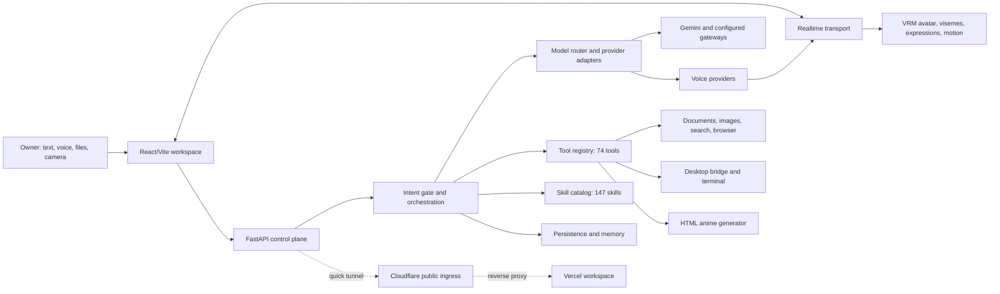
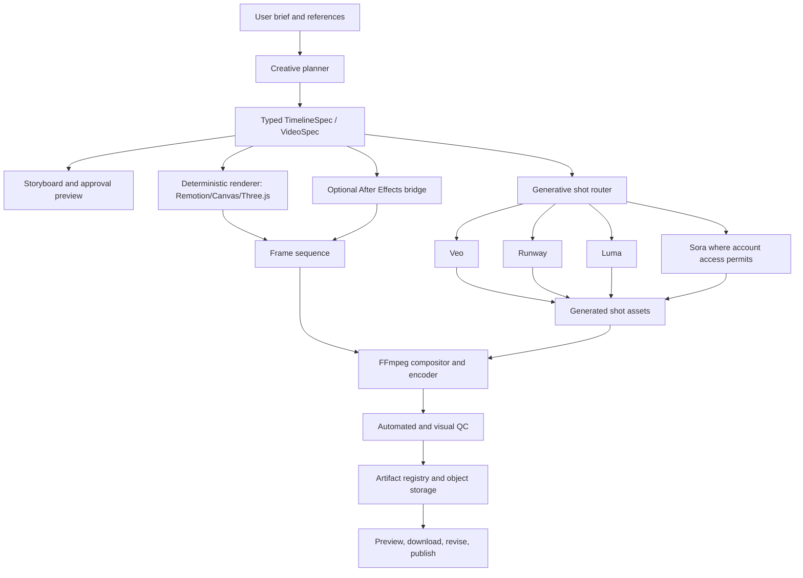

# HINAA Current Status, Target Architecture, and Video Roadmap

**Assessment date:** 2026-10-17 (Asia/Kathmandu)  
**Repository:** `HINAMYGIRL`  
**Revision inspected:** `f12c7e2` on `main`, plus the uncommitted working tree present during this assessment  
**Audience:** engineers and AI coding agents continuing HINAA  
**Assessment rule:** a capability is called verified only when this assessment found executable evidence for it. Source code, configuration, or a catalog entry alone is not proof that an external integration works.

## Executive verdict

HINAA is an ambitious, broad personal-agent platform with a substantial React interface, a FastAPI control plane, multi-provider model routing, streaming voice, a VRM companion, tool execution, a skill catalog, desktop and terminal adapters, document and image workflows, and a growing test suite. It is beyond a mock-up.

It is not yet a production-complete autonomous companion. At the time of this assessment the local API and local web app respond successfully, while the public production health endpoint returns HTTP 502. Several integrations are implemented at the adapter or UI level but are not proven end to end in the current runtime. The new HTML anime generator creates deterministic browser animations, but HINAA has no installed video renderer, no MP4/WebM export worker, no After Effects bridge, and no verified generative-video provider.

The correct description today is **advanced integrated prototype / pre-production agent platform**. The fastest path to a reliable high-end system is to stabilize deployment first, formalize an artifact and job architecture, then add deterministic motion rendering and one real generative-video provider before expanding to more providers.

## Evidence collected

| Check | Result | Interpretation |
|---|---:|---|
| Local API `http://127.0.0.1:8000/health/live` | HTTP 200 | API is running locally |
| Local web `http://127.0.0.1:5173/` | HTTP 200 | Vite UI is running locally |
| Public API through `https://hinaa-workspace.vercel.app/health/live` | **HTTP 502** | Public production path is currently broken |
| Frontend production build | Passed | TypeScript and Vite build successfully |
| Frontend tests | 91 files; 601 passed; 2 todo | Strong component/unit regression coverage |
| Full backend tests | 1,808 passed; **2 failed** out of 1,810 | Broad coverage passes, with a voice-speed contract regression |
| Focused backend acceptance tests | 38 passed | Skill, animation, lifecycle, model resilience, runner, remote-PC/MCP, terminal, and college-vault slices pass |
| Runtime tool registry | 74 registered tools | Broad callable surface exists |
| Skill catalog | 147 indexed skills in 8 categories | Catalog and discovery layer works locally |
| Source inventory | 39 tool modules; 26 provider modules | Considerable implementation breadth |
| Video runtime dependencies | FFmpeg absent; Remotion absent; `aerender` absent | No production video render/export lane exists |
| HTML animation compiler | Present | Browser-animation prototype has a compiler harness |
| Working tree | Many modified and untracked files | Current state needs review, consolidation, and a clean release commit |

The two full-suite failures are `test_warm_mode_is_persona_warm` and `test_every_advertised_pace_is_one_the_provider_will_accept`. Current uncommitted tuning sets the natural rate to `1.08` and HINAA's warm planned pace to `1.08`; the established tests require natural at or below `1.0` and warm at or below `0.95`. This is a real requirements conflict between “faster” voice tuning and the existing natural/tender persona contract. It should be resolved through measured first-audio latency and listening tests rather than by making playback speed compensate for slow generation.

External-provider health, browser audio playback, GPU performance, and desktop actions still require live end-to-end tests in addition to unit tests.

## Current architecture



### Frontend and companion

The frontend is a large React/Vite application with workspace modes, provider controls, rich tool responses, file and vision features, terminal surfaces, settings, responsive layouts, and a Three.js/VRM avatar. The avatar code includes model fallback, pre-frame VRM optimization, skeleton combination, expression mapping, blinks, gaze, body bones, hand bones, procedural movement, audio energy, and viseme-timeline support.

This is a serious avatar implementation, but code complexity is not motion quality proof. A realistic companion still needs measured frame-time budgets on target desktop and mobile devices, recorded lip-sync error, validated blend-shape compatibility per VRM, motion-capture retargeting, foot-lock and contact tests, and visual comparison against the selected movement reference.

The production build reports large chunks, including Mermaid, ELK, the main application bundle, and React Three Fiber/Three.js. Dynamic loading of the avatar is currently weakened by static imports elsewhere. Bundle splitting and conditional 3D loading are required for faster startup and low-power devices.

### Realtime voice

The code contains ElevenLabs streaming support, per-character alignment, retry and quota handling, language selection, cancellation, realtime transport, audio analysis, and client viseme playback. Deepgram and Azure Speech credentials are also configured. This is the right shape for simultaneous text and speech.

The remaining production proof is a repeatable latency trace for each turn:

1. microphone end-of-speech;
2. first transcript token;
3. first model token;
4. first TTS request;
5. first decoded audio frame;
6. first audible sample;
7. viseme-to-audio timing error;
8. turn cancellation and barge-in behavior.

Without these timestamps and browser playback evidence, the system cannot claim low-latency natural conversation even though the streaming pieces exist.

### Agent reasoning and model routing

HINAA has model-provider abstractions, routing metadata, answer-depth controls, lifecycle logic, model validation resilience, and multiple gateway integrations. Recent local logs show successful calls through an XKIRO gateway and model discovery through APMIX. Clerk JWKS retrieval also succeeded.

Some catalog health values are inferred from key presence or hard-coded metadata. Model names and capabilities from aggregators are not authoritative until a live capability probe succeeds. The router should store a time-bounded health record containing provider, model, endpoint, supported modalities, probe timestamp, latency, and failure class. A typo or stale model ID must degrade to a known fallback without inventing capability.

### Tools, skills, desktop, and terminal

The tool registry and skill catalog are functional and broad. They include browser/search, creative, document, system, desktop, terminal, college, social, and specialist workflows. The architecture has risk and permission metadata plus an intent gate.

Desktop and terminal code should be treated as **partial** in the current runtime. Earlier focused tests pass, but the desktop service was not listening during this assessment and the runner status file was stale. Local computer control also cannot become a reliable 24/7 cloud feature by itself: a cloud control plane needs a signed local worker connected over a persistent outbound channel, explicit approval policy, command audit log, timeouts, and safe recovery when the PC sleeps or disconnects.

### Authentication, persistence, and deployment

Clerk server and browser keys are configured. The live runner now fails closed unless it has an explicit Clerk owner ID; wildcard owner access is rejected. This is the correct security posture.

No durable `HINAA_DATABASE_URL` is configured in the scanned environment, so production memory, jobs, audit events, and artifact state need a managed Postgres service. The current public deployment depends on an account-less Cloudflare quick tunnel to a local PC. Its own logs state that it has no uptime guarantee, and the saved runner state points to processes that no longer exist. This design is the direct reason a healthy local app can coexist with a public HTTP 502.

Vercel is suitable for the static frontend and lightweight edge/control endpoints. It should not host long video renders, local-PC automation, or persistent realtime workers.

## Capability status matrix

| Area | Current status | Evidence | Required production work |
|---|---|---|---|
| Web workspace | **Verified locally** | Build and 601 tests pass; local HTTP 200 | Restore public ingress, browser E2E, accessibility and device matrix |
| Public deployment | **Broken** | Public health HTTP 502 | Durable API host or named tunnel; supervision and uptime alerting |
| Auth / owner gate | **Implemented; focused tests pass** | Clerk code and runner tests | Live owner session and access-denial E2E |
| Text generation | **Live through at least one gateway** | Successful XKIRO requests in local logs | Provider probes, SLOs, cost limits, authoritative model catalog |
| Voice generation | **Implemented; not live-verified in this assessment** | ElevenLabs streaming/alignment code and configured key | Browser audio E2E, latency tracing, quota/fallback tests |
| Speech recognition | **Configured; not live-verified** | Deepgram and Azure keys present | Streaming STT E2E, language and barge-in matrix |
| VRM avatar | **Advanced implementation; quality unverified** | Three.js/VRM bones, expressions, visemes, optimizations | FPS/thermal tests, retargeted mocap, lip-sync metrics, LOD |
| Image generation/editing | **Partial** | Creative tools and Magnific key | Verify each provider, artifact persistence, reference-image E2E |
| Documents/PDF | **Partial** | Tool/UI surface exists | Golden-document tests, export fidelity, fonts, pagination, storage |
| Browser automation | **Partial** | Tools and tests exist | Authenticated live-browser scenarios, recovery, audit trail |
| Desktop control | **Partial/offline now** | Focused tests pass; desktop listener absent | Signed local worker, reconnect, approvals, UI perception loop |
| Kali/terminal | **Partial** | WSL/terminal focused tests pass | Supervised sessions, streaming PTY, cancellation, policy and audit |
| Social integrations | **Scaffolding/partial** | Search and reach tools exist | Official OAuth apps, scoped tokens, per-platform read/write E2E |
| Outlook / Microsoft 365 | **Not configured** | Microsoft client credentials absent | Entra app, Graph scopes, tenant consent, webhook/subscription worker |
| GitHub/MCP | **Not configured in scanned env** | GitHub token absent | GitHub App or MCP OAuth, repository allowlist, action approvals |
| Memory/database | **Development-level** | No production DB URL | Managed Postgres, migrations, encryption, retention, backup/restore |
| HTML anime motion | **Prototype verified** | Generator and focused tests pass | Local asset bundling, render adapter, deterministic frame tests |
| MP4/WebM/GIF export | **Unavailable** | FFmpeg/Remotion absent | Install render stack; job and artifact pipeline |
| Generative video | **Unavailable and currently policy-blocked** | Video requests rejected in validation/tools/tests | Replace blanket ban with approved provider policy and implement adapter |
| After Effects automation | **Unavailable** | AE/aerender absent; no JSX bridge | Licensed AE worker, JSX generator, template contracts, aerender queue |

## Configured integration inventory

Only presence was checked; secret values were not printed.

**Configured:** Gemini, ElevenLabs, Deepgram, Azure Speech, Magnific, Clerk server, Clerk browser, Exa.

**Not configured under the scanned standard names:** OpenAI, Anthropic, Google generic API key, Groq, Stability, Replicate, fal, Runway, Luma, Kling, Veo, GitHub, Microsoft Entra client credentials, production database, You.com.

Gateway-specific credentials may use different names. A configured key means only that a non-placeholder value exists; it does not prove quota, entitlement, model access, or successful requests.

## Video and motion-graphics assessment

The phrase “Claude Canto-level motion graphics” does not identify a stable public video API in this repository. This report interprets the goal as premium, design-directed motion graphics with precise typography, transitions, compositing, audio synchronization, and cinematic generated shots.

Three different capabilities must remain separate:

1. **Deterministic motion graphics** — text, shapes, charts, UI, SVG, 2D/3D layers, keyframes, transitions, captions, and exact timing. This is the After Effects-like lane.
2. **Generative cinematic shots** — a model produces new moving imagery from text, images, first/last frames, or a reference video. This lane is visually powerful but less deterministic.
3. **Final composition** — editing, color, audio, captions, effects, encoding, quality control, and delivery.

HINAA currently has the beginning of lane 1 through `html_anime_generate`. It emits standalone HTML/SVG/CSS/GSAP animations for fixed durations and aspect ratios and mirrors them into the web app. It does not render a video file. It also uses CDN-loaded GSAP and fonts, which prevents fully offline and reproducible rendering.

### Target video architecture



### The key contract: `TimelineSpec`

Every planner and renderer should exchange one versioned, validated representation rather than provider-specific prompt strings:

```json
{
  "schemaVersion": "1.0",
  "projectId": "video_...",
  "canvas": { "width": 1920, "height": 1080, "fps": 30, "durationFrames": 450 },
  "brand": { "palette": ["#090B14", "#F54BA5"], "fontFamilies": ["Inter"] },
  "audio": { "voiceAssetId": "asset_...", "musicAssetId": "asset_...", "targetLufs": -14 },
  "scenes": [
    {
      "id": "scene_01",
      "startFrame": 0,
      "durationFrames": 120,
      "layers": [
        {
          "id": "title",
          "kind": "text",
          "content": "HINAA",
          "keyframes": [
            { "frame": 0, "opacity": 0, "y": 64 },
            { "frame": 18, "opacity": 1, "y": 0, "easing": "easeOutCubic" }
          ]
        }
      ]
    }
  ],
  "deliverables": ["preview.mp4", "master.mp4", "captions.srt", "poster.png"]
}
```

The schema should include assets, masks, cameras, 3D transforms, safe zones, transitions, generated-shot provenance, caption timing, and renderer-specific extensions. Schema migrations must preserve old projects.

### Recommended render lanes

#### 1. Deterministic renderer — build first

Use Remotion as the TypeScript composition layer and FFmpeg as the final encoder. Remotion can render videos, stills, image sequences, and GIFs and supports server-side and cloud rendering. The worker should vendor fonts and JavaScript locally, render exact frames, then use FFmpeg for audio mixing, normalization, subtitles, concatenation, thumbnails, and MP4/WebM output.

This lane delivers polished explainers, UI demos, lyric videos, animated reports, typography, charts, and social clips with frame-perfect reproducibility. It is the closest web-native path to programmable After Effects.

#### 2. Generative shot providers — add one, then expand

Start with one provider behind a common asynchronous adapter:

```text
submit(spec, references) -> providerJobId
poll(providerJobId) -> queued | running | succeeded | failed
cancel(providerJobId)
fetch(providerJobId) -> immutable asset
estimate(spec) -> cost and expected time
```

Google Veo is the best first fit if HINAA will use Google Cloud: the official Vertex AI API supports text-to-video and image-guided workflows, including first/last-frame generation. It requires a Google Cloud project, Vertex AI enablement, billing, suitable IAM/service-account credentials or Application Default Credentials, and a GCS bucket. The current simple Gemini API key should not be assumed sufficient.

Runway and Luma are sensible second adapters. Both use asynchronous job patterns. OpenAI's current model catalog also lists Sora video models, subject to API/account availability. Provider access, geography, pricing, output rights, limits, and moderation must be verified for the owner's account before exposing a model in the UI.

#### 3. After Effects bridge — optional local specialist worker

After Effects supports ExtendScript (`.jsx`) automation and command-line rendering through `aerender`. HINAA can generate a JSX script or populate an approved `.aep` template from `TimelineSpec`, then enqueue `aerender` on a Windows worker.

This requires:

- a licensed After Effects installation;
- curated templates with stable composition and layer names;
- an allowlisted JSX generator rather than arbitrary generated scripts;
- a local worker token and outbound-only connection to the control plane;
- template versioning, font/plugin checks, render timeout, and log capture;
- explicit policy for third-party plugins and missing assets.

After Effects is not installed or discoverable on the assessed machine, so this lane cannot work until the software and worker are provisioned.

### Video control plane and infrastructure

The frontend should submit a render job and receive an ID immediately. Rendering must happen outside a request/response process.

| Component | Recommended responsibility |
|---|---|
| FastAPI control plane | Validate specs, authorize jobs, estimate cost, expose status and artifacts |
| Managed Postgres | Projects, specs, jobs, approvals, provider state, cost, audit records |
| Redis/queue | Dispatch, retries, cancellation, leases, progress events |
| S3/GCS/R2 | Reference uploads, generated shots, frames, proxies, masters, captions |
| CPU render worker | Remotion/Chromium and FFmpeg compositions |
| GPU worker | Optional local models, upscaling, interpolation, segmentation |
| Provider workers | Veo/Runway/Luma/Sora asynchronous submit/poll/webhook adapters |
| Local AE worker | Template rendering through JSX and `aerender` |
| Realtime channel | Progress, preview availability, warnings, approval requests |

All jobs need idempotency keys, bounded retries, cancellation, provider webhook verification, signed upload/download URLs, cost ceilings, and immutable provenance.

### Video quality gates

A rendered file is not “perfect” until automated checks and a visual review pass:

- exact dimensions, frame rate, duration, codec, pixel format, and audio channels;
- no missing assets, decode errors, black/frozen frames, unexpected alpha, or dropped frames;
- caption timing, spelling, contrast, and title/action-safe placement;
- audio peak and integrated loudness targets; no clipping or long silence;
- deterministic frame hashes for unchanged deterministic projects;
- continuity checks between generated shots and reference identity checks where permitted;
- preview proxy before master render;
- mobile and desktop playback in target browsers;
- cost, provider, prompt, seed, model version, and source-asset provenance retained.

## What remains, in priority order

### P0 — restore truth and reliability

1. Replace the stale quick-tunnel deployment with a durable API host or a named Cloudflare Tunnel with a supervised connector. Restore the public health endpoint and add an external uptime check.
2. Consolidate the dirty working tree into reviewed commits. Resolve the two ElevenLabs pace regressions, rerun the full backend suite, and run authenticated browser smoke tests before release.
3. Add a `/v1/readiness` report that checks database, model provider, voice provider, object storage, queue, desktop worker, and tunnel independently. Never label a provider healthy from key presence alone.
4. Configure managed Postgres and migrations; add backup and restore testing.
5. Make the runner state authoritative: PID identity, heartbeat expiry, child-process ownership, restart budget, and crash reason.

### P1 — finish the companion experience

1. Add end-to-end voice latency telemetry and a browser test that hears decoded audio, confirms text/audio overlap, and measures viseme drift.
2. Convert TTS to sentence/phrase streaming with backpressure, cancellation, and barge-in. Cache stable phrases only when voice/model/settings match.
3. Profile the avatar at 320 px mobile, mid-range laptop, and high-end desktop targets. Add automatic LOD, render-scale, shadow, post-processing, and FPS adaptation.
4. Retarget cleaned motion-capture clips for idle, listening, thinking, speaking, explaining, celebrating, walking, and transitions. Blend clips through a state machine; add foot locking and gaze constraints.
5. Split large frontend chunks and load 3D, Mermaid/ELK, terminal, and heavy editors only when opened.

### P1 — establish the media platform

1. Define `TimelineSpec`, `Asset`, `RenderJob`, `ProviderJob`, and `Artifact` schemas.
2. Install Remotion and a pinned FFmpeg runtime in a reproducible worker image.
3. Convert `html_anime_generate` output into a renderer adapter; vendor its runtime assets.
4. Implement preview, frame sequence, MP4, WebM, GIF, poster, subtitles, and metadata outputs.
5. Add object storage, job queue, progress events, cancellation, retries, QC, and artifact retention.

### P2 — add generative video and AE

1. Provision Google Cloud/Vertex/GCS and implement Veo as the first verified provider, or choose Runway if its account access and pricing are preferable.
2. Replace the current blanket video ban with a capability policy: approved providers, user/owner permissions, cost ceiling, reference consent, and publication approval.
3. Add provider-independent reference-image, first/last-frame, duration, aspect, camera, and negative-prompt controls.
4. Add Runway/Luma/Sora adapters only after the first adapter passes the same contract tests.
5. Install and license After Effects on a dedicated worker; implement allowlisted JSX templates and `aerender` orchestration.
6. Build the storyboard/timeline UI with scene cards, layers, keyframes, easing curves, captions, audio waveform, provider selection, cost estimate, preview, and revision history.

### P2 — complete external automation

1. Microsoft 365: create an Entra application, use OAuth authorization code flow, request the minimum Graph mail/calendar scopes, obtain tenant/admin consent where required, encrypt refresh tokens, and use Graph change notifications with renewal.
2. GitHub: prefer a GitHub App or OAuth/MCP connection over a broad personal token; restrict repositories and require approval for push, merge, release, or destructive actions.
3. Social platforms: implement each platform through official OAuth and APIs, separating read/search, draft, and publish permissions. Publishing must show the final content and destination before approval.
4. Remote PC: deploy a signed local worker with outbound mTLS/WebSocket, screen perception, structured UI actions, allowlisted shell/desktop tools, consent states, audit logs, and an emergency stop.
5. Cloud agent: keep planning, memory, schedules, and API integrations in the cloud; route physical-PC actions only to an online authorized device.

## Required accounts, credentials, and services

| Goal | Required setup |
|---|---|
| Durable HINAA API | Cloud host/container platform, domain/TLS, secrets manager, monitoring |
| Database | Managed Postgres URL, migrations, encryption and backups |
| Job processing | Redis or managed queue plus supervised workers |
| Media storage | S3/GCS/R2 bucket, CORS, signed URLs, lifecycle policy |
| Deterministic video | Node/Chromium, Remotion, pinned FFmpeg, fonts and codecs |
| Veo | GCP project, billing, Vertex AI API, IAM/service account or ADC, GCS bucket |
| Runway | Runway developer account and API key |
| Luma | Luma API account/key and webhook endpoint |
| Sora | OpenAI project/API key and confirmed video-model entitlement |
| After Effects | Licensed desktop/server installation, templates, plugins/fonts, local worker |
| Outlook school/work | Microsoft Entra tenant app, client ID/secret or certificate, redirect URI, Graph scopes and consent |
| GitHub | GitHub App/OAuth/MCP connection, installation, repository allowlist |
| Social platforms | Separate developer app and OAuth credentials for every platform |
| PC control | Installed signed HINAA worker, device identity, local permissions, emergency stop |

No report or code change can create paid provider entitlements, tenant consent, application licenses, or cloud billing. Those external prerequisites must be provisioned in the owner's accounts and then verified through HINAA's health probes.

## Production acceptance criteria

HINAA should be called production-ready only when all applicable gates pass:

- Public workspace and API meet an agreed uptime SLO for at least seven continuous days.
- Every advertised provider has a recent live probe and a tested fallback.
- Owner authentication, denial, session expiry, and webhook signatures pass E2E tests.
- Text, voice, image, document, browser, terminal, and desktop golden journeys pass from the deployed UI.
- Voice latency and avatar FPS meet written targets on the supported device matrix.
- Tool actions are auditable, cancellable, permissioned, and recover safely after disconnects.
- Database restore and artifact restore have been exercised.
- A video project can move from brief to storyboard, preview, master render, QC, download, and revision without manual file surgery.
- Video outputs pass technical QC, and provider cost/provenance are visible.
- Full backend and frontend suites, production build, security checks, and authenticated browser smoke tests pass against the release revision.

## Handoff instructions for another AI or engineer

1. Read this report before relying on older capability documents; several older documents describe intentions as completed features.
2. Preserve the current user's uncommitted work. Inspect `git status` and diff before editing.
3. Reproduce the local/public health checks and inspect `.runtime/live/runner-state.json`; reject stale heartbeats.
4. Do not claim a provider works from an environment variable or model catalog entry. Run a bounded, non-destructive probe.
5. Keep deterministic motion rendering, generative video, and After Effects automation as separate adapters over the same `TimelineSpec`.
6. Start with the P0 deployment and persistence work. A larger provider catalog will not fix the current HTTP 502 or missing render workers.
7. Update this report with exact evidence, timestamps, and release revision after each production milestone.

## Primary technical references

- Google Vertex AI Veo text-to-video: <https://cloud.google.com/vertex-ai/generative-ai/docs/video/generate-videos-from-text>
- Google Vertex AI first/last-frame video: <https://docs.cloud.google.com/vertex-ai/generative-ai/docs/video/generate-videos-from-first-and-last-frames>
- Runway API SDKs and tasks: <https://docs.dev.runwayml.com/api-details/sdks/>
- Runway API getting started: <https://docs.dev.runwayml.com/guides/using-the-api/>
- Luma create-generation API: <https://docs.lumalabs.ai/reference/creategeneration>
- Luma modify-video API: <https://docs.lumalabs.ai/reference/modifyvideo>
- OpenAI model catalog: <https://platform.openai.com/docs/models>
- Adobe After Effects automation: <https://helpx.adobe.com/after-effects/desktop/automate-in-after-effects/automate-animation/automation.html>
- Adobe After Effects scripts: <https://helpx.adobe.com/after-effects/desktop/automate-in-after-effects/automate-animation/scripts.html>
- Adobe `aerender` automation: <https://helpx.adobe.com/after-effects/desktop/render-and-export/automate-rendering/automated-rendering-network-rendering.html>
- Remotion rendering: <https://www.remotion.dev/docs/render>
- Remotion API: <https://www.remotion.dev/docs/api>
- Remotion Lambda: <https://www.remotion.dev/docs/lambda>

