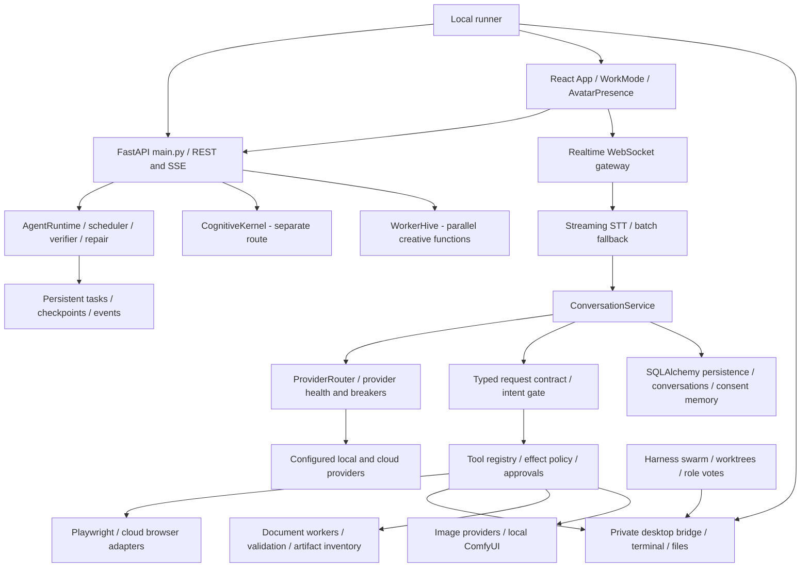

# HINAA initial repository audit and first reliability repair

Date: 2026-11-04. Intended audience: the owner and another AI continuing implementation. This report evaluates the existing working tree against the supplied HINAA OS engineering brief. It is not a claim that the brief, a security audit, a model benchmark, or the full agent architecture is complete.

## Executive finding

Hina already contains substantial execution, persistence, artifact and voice infrastructure. The largest architectural problem is inconsistent authority and completion semantics across overlapping execution paths, rather than absence of another orchestration framework. Preserve the current stack and unify behavior through tests before expanding autonomy.

The existing dirty tree was inspected and preserved. Earlier streaming voice, avatar, ComfyUI, RAG, Freepik and provider work was not reset. No dependencies, model weights, infrastructure, authentication policy, DNS or public deployment were changed in this milestone.

## Scope and method

The structural scan covered 294 active backend Python files and 363 frontend TypeScript/TSX files, with 315 route declarations including aliases, 195 backend test files before this milestone and 98 frontend test files. Backend sources parsed without syntax errors. ZIP archives, reference-model projects, installed packages, generated artifacts and the nested enterprise starter are not treated as active production implementation merely because they exist in the repository.

`scripts/audit_hinaa_repository.py` generates the detailed file-area, provider-class, route and dependency inventory without importing application modules or reading secrets. See `docs/audits/hinaa-repository-inventory-2026-11-04.json`. Test-file counts in that final inventory include this milestone's new regression file. This is structural coverage and targeted source review, not an assertion that every line was semantically audited.

## Current architecture



This diagram distinguishes separate paths; it does not imply every subsystem is one unified supervisor. `main.py` wires `AgentRuntime`, persistent task services, `MemoryManagerV2`, the cognitive kernel and creative workers independently. The main entry points are `apps/api/hinaa_api/main.py:create_app`, `services.py:ConversationService`, `apps/web/src/main.tsx`, `App.tsx`, `apps/desktop/src/main.cjs`, and `scripts/live_runner.py`. The API supports REST, SSE and WebSockets; the presence of harness abstractions does not make every conversation a JSON-RPC agent workflow.

## Feature inventory: implementation versus proof

| Area | Existing implementation | Evidence and remaining gap |
|---|---|---|
| Request understanding | `tools/request_contract.py`, `intent_gate.py`, `agent/intent.py` | Typed clause modes and deliverables already exist; execution-milestone tests exercise discussion, questions, negation, cancellation and artifacts. Several other planners still use keyword heuristics. |
| Main reasoning/chat | `services.py`, `prompts/`, `response/` | Prompt construction, context selection and token streaming exist. No benchmark in this audit establishes frontier reasoning quality, p95 response time, or every configured provider's reliability. |
| Models | `ProviderRouter`, `providers/`, `circuit_breaker.py`, `cognitive/resilient_router.py` | 24 accepted mode identifiers, not 24 independently verified working models. Configured gateways and static quality priors are not benchmark results. |
| Voice | `realtime.py`, `providers/streaming_stt.py`, `useLiveConversation.ts`, turn-taking controller | Earlier live synthetic English tests verified both streaming vendors. User microphone accuracy, Nepali/Hindi code-switching, echo, repeated interruption and spoken-answer p95 remain unverified. |
| Browser and PC | Multiple `tools/browser*` modules, `computer_operator.py`, desktop daemon, `integrations/remote_pc.py` | Actual adapters exist; one browser module uses shared global page/session state rather than universal per-task contexts. A ready desktop daemon is not proof of correct application control. No real browser/PC actions were executed for this audit. |
| Coding | `agent/coding_agent.py`, `coding_agent_tool.py`, harness worktrees, command runner | Patch/repair and test infrastructure exist. The command runner launches host subprocesses with cwd/env/time bounds; this is not equivalent to disposable OS/container isolation. |
| Research | Search tools, `grounding/citations.py`, evidence/claim tests | Citation structures exist. Real current-news accuracy and source verification were not benchmarked; filler research output must not be described as researched facts. |
| Documents | `tools/pdf_generate.py`, `document_generate.py`, `artifacts/` | Existing baseline tests exercise a real PDF worker, validation, registration and TestClient download. Office exporters build OOXML directly using ZIP/XML; missing python-docx/openpyxl is not by itself a blocker for those native exporters. Visual document quality is not established by file validity. |
| Creative work | `providers/local_comfyui.py`, `creative/`, image generation tools and workflows | Bridge and dependency/file validation exist. Local port 8188 is unreachable in this audit. Actual ComfyUI output remains unverified. |
| Durable memory | `persistence/memory_service.py`, conversation summaries, explicit-memory routes | Consent/review/delete and owner-aware storage exist. A current regression fails when `_capture_turn_facts(request, None)` returns true; do not describe ownerless durable-memory claims as fixed. |
| Memory v2 | `memory_v2/manager.py`, cognitive consolidation | The manager itself stores partitions in in-process dictionaries/lists. This is different from the SQL-backed MemoryService. Session bootstrap also reads a shared project state file. |
| Background work | SQL task records, `durable/runtime.py`, reminders, heartbeat, API tasks | Persistence/checkpoints and recovery code exist; many workers are in-process `asyncio` tasks. No independently deployed worker or exactly-once external action guarantee was proven. |
| Specialist agents | `agents/orchestrator.py`, `worker_hive.py`, `harness/swarm_orchestrator.py` | Includes keyword decomposition, parallel functions and worktree/role scoring. The default harness synthesizer creates a manifest and checks syntax; that is not verified autonomous feature implementation by six independent specialists. |
| Self-improvement | Repair controllers, coding loop, worktree helpers, evaluation fixtures | No complete observe-to-reviewed-patch-to-approved-deploy loop was verified. Harness `promoted_to_main` can reflect a successful worktree commit without an observed merge to main. |
| Integrations | GitHub MCP, Microsoft Graph Outlook, remote desktop adapters | Code exists. This audit did not read mail, connect accounts, post messages, alter repositories or validate social-network access. Outlook's current delegated cache uses Windows DPAPI and needs a different secret-storage strategy on a cloud host. |

## Provider and dependency inventory

Accepted provider modes are: `gmi`, `auto`, `mock`, `local`, `groq`, `openai`, `custom`, `real`, `claude`, `qwen`, `agent-router`, `cx-gateway`, `gemini-live`, `codecraft`, `ollama`, `omniroute`, `pgsgrove`, `seekai`, `tokentable`, `xkiro`, `cavoti`, `apmix`, `oxion`, and `experiential`. Multiple identifiers use OpenAI-compatible or Anthropic-compatible adapters. DeepSeek/NextProxy names must be mapped to actual gateway configuration rather than counted as separately operational services from their labels.

The manifest inventory records exact declared and installed backend versions. All packages declared in `apps/api/requirements.txt` were present in the audit interpreter. Principal declarations include FastAPI 0.141.1, Uvicorn 0.52.0, Pydantic 2.13.4, SQLAlchemy 2.0.43, HTTPX 0.28.1, Playwright 1.63.0, ReportLab 4.4.5 and pypdf 6.19.0. The web manifest uses React 19.2.8, TypeScript 7.0.2, Vite 8.1.5, Three 0.185.1, three-vrm 3.5.5, Vitest 4.1.10 and frontend Playwright 1.62.0. Exact full manifests and route sources are in the JSON inventory; version declarations alone do not establish compatibility or lack of vulnerabilities.

The current interpreter has Pillow 12.3.0 and Browserbase 1.21.0, neither declared in the main backend requirements list. That is a reproducibility gap for paths importing them. LangGraph, Redis, Transformers and PEFT are not installed here and are not declared in that backend manifest. Installing them is not the first repair. This audit did not run a vulnerability database scan or install/update any package.

## Actual runtime and performance observations

| Check | Observed result |
|---|---|
| Local API `/health/live` | HTTP 200, 7 ms for this single request |
| Local frontend `/` | HTTP 200, 4 ms |
| Local `/v1/readiness` | HTTP 200, status `ready`, 160 ms; this is not proof of all integrations |
| ComfyUI `/object_info` | Connection failed on port 8188 |
| Public Vercel frontend `/` | HTTP 200, 222 ms |
| Public `/health/live` | HTTP **502**, 80 ms |
| Repository-configured temporary Cloudflare backend `/health/live` | Connection failed |
| Docker | CLI installed; Docker Linux engine named pipe unavailable |
| WSL | `kali-linux`, `docker-desktop`, `docker-desktop-data` are listed; Linux task execution was not tested |

The deployed public HTML is reachable while its backend health route fails. Repository Vercel rewrites point to a temporary `trycloudflare.com` origin; Render and Docker deployment manifests also exist. These represent multiple deployment intentions, not proof of one functioning backend. Actual deployed rewrite metadata was not retrieved from Vercel management APIs, so the precise deployed target is not certified. No DNS, tunnel or deployment was changed.

Earlier real synthetic English voice probes measured a 4.575-second sentence: ElevenLabs first partial 3820 ms and final 859 ms after commit; Deepgram first partial 2812 ms, connection ready 2078 ms, final 565 ms after commit. These are single service checks, not end-to-end conversational or multilingual benchmarks. Main chat time-to-first-token, first audible response, p50/p95, GPU FPS, memory pressure and autonomous task completion rate remain unmeasured. Do not replace those unknowns with a two-second or human-level promise.

## First bounded reliability repair completed

Source review and new regression tests reproduced the stored failed-launch claim: the cognitive kernel assigned `completed` after any returned tool value, including `success: false`; SessionBridge also invented a checked “General session activity” item when no tasks were supplied. Six new checks failed before the repair.

Changes:

- `cognitive/kernel.py`: external results require a structured dictionary with `success is True` and `verified is True`; failed, missing or unverified results fail the step and overall verification. Failed steps emit `step.failed` and appear as unresolved in the session summary.
- The separate, unconnected cognitive model-synthesis placeholder now reports `MODEL_EXECUTION_NOT_CONNECTED` instead of claiming a response was generated. Normal chat continues through ConversationService; no model provider was replaced.
- `cognitive/session_bridge.py`: an empty completion list no longer creates a checked task.
- `tests/test_cognitive_result_truthfulness.py`: covers failed/unverified/invalid outcomes, positive completion, empty summaries and the disconnected model path.
- `tests/test_cognitive_core.py`: its positive execution test now uses an explicit verified mock result and isolated audit dependencies rather than invoking the real computer operator.

This repair checks the existing tool result contract. It does not independently prove every tool's `verified` flag, repair old stored summaries, unify all orchestrators or modify an authorization policy. The existing historical `.hina/current-state.md` was preserved.

## Test evidence and remaining failure

New regressions before repair: **6 failed, 1 passed**. The final cognitive regression run, including observation-processing failure, passed **14 tests** in 5.40 seconds. All desktop execution in these checks was mocked; no application was opened.

The wider audit baseline ran:

```powershell
apps/api/.venv/Scripts/python.exe -m pytest apps/api/tests/test_execution_milestone.py apps/api/tests/test_agent_runtime_foundation.py apps/api/tests/test_memory_privacy.py apps/api/tests/test_artifact_inventory.py apps/api/tests/test_durable_tasks.py apps/api/tests/test_tool_policy.py -o addopts= -q
```

Result: **113 passed, 1 failed**. Remaining failure: `test_memory_privacy.py::test_she_only_claims_a_memory_she_can_actually_keep`, because `_capture_turn_facts(request, None)` unexpectedly returns true. This is not a claim that anonymous HTTP routes were demonstrated to leak memory; it is a failing service-level ownership/claim invariant that needs separate repair. It was not hidden, weakened or repaired by changing authentication in this milestone.

Repair verification:

```powershell
apps/api/.venv/Scripts/python.exe -m pytest apps/api/tests/test_cognitive_result_truthfulness.py apps/api/tests/test_cognitive_core.py -o addopts= -q
```

The preceding voice checkpoint's full frontend run passed 642 tests with two TODOs; that count is carried forward as earlier evidence, not a newly rerun full frontend suite. TypeScript and the production web build were rerun successfully during this audit; existing large-bundle warnings remain. Raw logs and runtime observations are under `.runtime/initial-audit-*` and `.runtime/audit-truthfulness-*`. A Google SDK deprecation warning remains. No visual browser, live PC task, mailbox or cloud deployment was verified here.

## Prioritized implementation plan and acceptance gates

| Priority | Bounded milestone | Required proof before expanding scope |
|---|---|---|
| P0 | Unify success/failure receipts across WorkerHive, harness promotion, cognitive and agent execution | Failure injection cannot produce a completed card/summary; a worktree commit cannot be called a production merge. The cognitive subset is repaired above; other paths remain open. |
| P0 | Repair ownerless memory claims and check context scoping | Repeated signed-in/out and cross-owner cases pass; consent-off and deletion remain effective; shared project notes do not become another user's private context. Prepare separately from authentication changes. |
| P0 | Restore a reviewed public backend path | Identify the intended persistent deployment; verify public backend, frontend API requests and authenticated WebSocket upgrade separately. Deploy only after explicit authorization. |
| P1 | Voice responsiveness and multilingual evaluations | Reproducible consented English/Nepali/Hindi/code-switch fixtures; pauses and barge-in preserved; measured first-partial and first-audio distributions. Include connection startup as a separate metric. |
| P1 | One verified browser/coding task | Read/modify only an isolated project; observe the browser or test output; demonstrate failure, cancellation and reviewable diff without production merge. |
| P1 | Real execution isolation | Verify an available container/VM worker with filesystem, network, process and resource boundaries; do not call a host subprocess wrapper a disposable sandbox. |
| P1 | Complete creative workflow | Start the approved ComfyUI service; verify graph/model readiness, queue execution, actual valid output, registered artifact, download and failure UI. |
| P2 | Durable background worker lifecycle | Crash/restart a worker mid-task; retain checkpoints; prevent duplicate external effects; support owner-scoped cancellation, limits and notifications. |
| P2 | Standardize existing memory and orchestration interfaces | Select one canonical authority per execution boundary; make adapters explicit before adding another engine/database/framework. |
| P3 | Controlled self-improvement and specialist orchestration | Diagnose a real regression, create an isolated patch, run meaningful tests, present evidence and rollback, then require approval before merge/deploy. No autonomous production policy rewriting. |
| P3 | Local model adaptation | Only after a curated evaluation baseline, resource measurements and data rights are established. No model training was performed here. |

The next execution milestone should cover one failure-sensitive workflow through the existing engine, not introduce another named “OS” or more providers. The creative hive's unconditional top-level success and the harness's misleading promotion field are concrete next truthfulness targets.

## Rollback limited to this milestone

Review and reverse only the new hunks in `cognitive/kernel.py`, `cognitive/session_bridge.py` and `tests/test_cognitive_core.py`. Remove the newly added truthfulness test, structural inventory script and audit artifacts only after checking for later edits. Preserve all earlier dirty-tree changes. Restart only the owned local API if rolling back live runtime code. No dependency, API-key, schema, authentication-policy or deployment rollback is required because none was changed.
