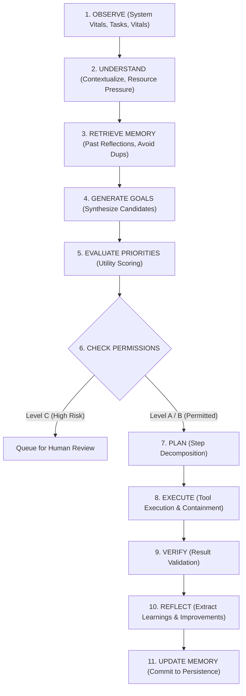

# HINAA INDEPENDENT AGENCY ENGINE — ARCHITECTURE & SPECIFICATION
**Module**: MODULE 01 — INDEPENDENT AGENCY ENGINE  
**Package**: `apps/api/hinaa_api/agency/`  
**Date**: November 4, 2026  
**Status**: ACTIVE & INTEGRATED  

---

## 1. Overview & Vision

HINAA is designed as an independently operating AI character with bounded autonomy and persistent identity. Rather than remaining a passive chatbot waiting for human prompts, Hina possesses an internal decision-making cycle that observes the environment, evaluates system health, proposes high-value goals, executes low-risk approved tasks, and updates persistent memory through self-reflection.

### Technical Boundaries & Accountable Autonomy
- **Simulated Character Initiative**: Autonomous actions are software tasks (code audits, telemetry monitoring, research summaries, ADB device checks) executed within authorized sandboxes.
- **No Unrestricted Permissions**: Autonomous actions adhere strictly to three permission tiers (Level A, Level B, Level C).
- **No Infinite Loops**: Built-in budget throttles (default: 10 autonomous goals per hour) and SHA-256 goal deduplication prevent runaway loops.

---

## 2. The 11-Step Bounded Agent Cycle

Hina's internal thought and action loop executes through 11 bounded stages:



### Stage Details:
1. **OBSERVE**: Inspects hardware memory pressure, CPU usage, git status, open tasks, and research queues.
2. **UNDERSTAND**: Builds situational awareness (e.g. "System under normal pressure; idle window detected").
3. **RETRIEVE MEMORY**: Queries historical reflections and previous task outcomes to avoid repeating past errors.
4. **GENERATE GOALS**: Produces candidate proposals across 6 categories: `research`, `maintenance`, `project`, `learning`, `creative`, `system`.
5. **EVALUATE PRIORITIES**: Ranks goals using the utility formula:
   $$\text{Utility Score} = \frac{\text{Expected Impact} \times \text{Confidence}}{\text{Resource Cost} + 0.1}$$
6. **CHECK PERMISSIONS**: Applies tiered governance:
   - **Level A (Independent)**: Auto-approved (safe read-only, telemetry, internal memory).
   - **Level B (Controlled)**: Permitted in sandboxed developer workspace.
   - **Level C (Approval Required)**: Blocked from autonomous execution; requires human-in-the-loop authorization.
7. **PLAN**: Decomposes the goal into verifiable `TaskStep` records with designated tools and parameters.
8. **EXECUTE**: Dispatches each step sequentially through sandboxed tool executors with per-step timeouts.
9. **VERIFY**: Assesses outputs against success criteria.
10. **REFLECT**: Evaluates what worked, what failed, and generates structured lessons.
11. **UPDATE MEMORY**: Commits learnings and updates the goal hash set to guarantee deduplication.

---

## 3. Data Models (`apps/api/hinaa_api/agency/models.py`)

- `ProposedGoal`:
  - `goal_id`: Unique identifier (`goal-{uuid}`)
  - `title`, `description`, `category`, `priority`
  - `permission_tier`: `LEVEL_A_INDEPENDENT`, `LEVEL_B_CONTROLLED`, `LEVEL_C_APPROVAL_REQUIRED`
  - `expected_impact` ($0.0 \dots 1.0$), `resource_cost` ($0.0 \dots 1.0$), `confidence` ($0.0 \dots 1.0$)
  - `score`: Computed utility ranking
  - `status`: `PROPOSED`, `EVALUATED`, `APPROVED`, `PLANNING`, `EXECUTING`, `VERIFYING`, `COMPLETED`, `FAILED`
  - `plan`: Associated `TaskPlan`
  - `reflection`: Associated `ReflectionRecord`
- `TaskPlan` & `TaskStep`: Structured execution steps with status, duration, result, and error containment.
- `ReflectionRecord`: Structured self-critique capturing `key_learnings`, `improvements`, and `memory_updates`.

---

## 4. REST API & Daemon Integration

The `AgencyRuntime` runs as an asynchronous background daemon alongside `AutonomousHeartbeatDaemon`:
- `GET /api/agency/status`: Operational state, running/paused flags, budget remaining, recent goals, and reflections.
- `POST /api/agency/trigger`: On-demand manual trigger for testing and administrative oversight.
- `POST /api/agency/pause`: Instant administrative emergency pause switch.
- `POST /api/agency/resume`: Resume autonomous decision cycles.

### Live Benchmark Evidence:
```json
{
  "triggered": true,
  "goal": {
    "goal_id": "goal-49a78631",
    "title": "BlueStacks 5 Emulator Connectivity & Package Audit",
    "category": "system",
    "status": "completed",
    "score": 2.464,
    "plan": {
      "summary": "Plan to execute: BlueStacks 5 Emulator Connectivity & Package Audit",
      "steps": [
        {"description": "Check ADB device connectivity via HD-Adb", "status": "completed"},
        {"description": "Inspect active Android packages and battery level", "status": "completed"}
      ]
    },
    "reflection": {
      "success": true,
      "key_learnings": ["Successfully accomplished 'BlueStacks 5 Emulator Connectivity & Package Audit' with utility score 2.464."]
    }
  }
}
```

---

## 5. Verification & Test Suite

All 5 comprehensive unit tests in `apps/api/tests/test_agency_engine.py` pass:
- `test_proposed_goal_utility_scoring`: Verified mathematical utility calculation.
- `test_decision_cycle_steps`: Verified all 11 stages execute sequentially without error.
- `test_permission_tier_enforcement`: Verified Level A/B auto-approval and Level C restriction.
- `test_duplicate_goal_prevention`: Verified hash-based suppression of repeated activities.
- `test_agency_runtime_budget_and_pause`: Verified hourly budget enforcement and emergency pause switch.
