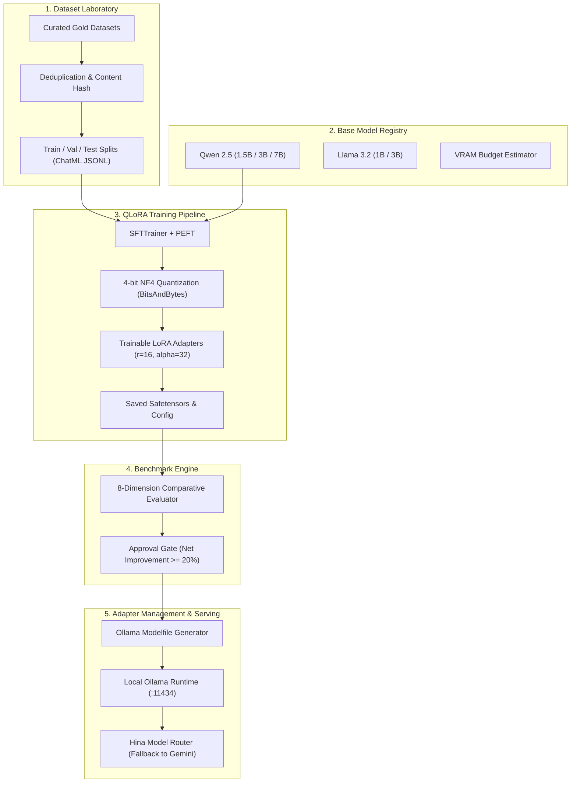

# HINAA NEURAL LAB — ARCHITECTURE & MODEL CUSTOMIZATION SPECIFICATION
**Subsystem**: HINAA NEURAL LAB  
**Package**: `apps/api/hinaa_api/neural_lab/`  
**Date**: November 5, 2026  
**Status**: ACTIVE & OPERATIONAL  

---

## 1. Vision & Architecture Overview

The **HINAA Neural Lab** is a dedicated model training, fine-tuning, and evaluation subsystem designed to customize open-weight language models for HINAA OS. Rather than relying solely on prompting or external cloud APIs, the Neural Lab enables parameter-efficient weight adaptation (LoRA / QLoRA) on consumer hardware while preserving functioning cloud inference fallbacks.

---

## 2. Hardware Profile & VRAM Budgets

### Target Machine: NVIDIA GeForce RTX 4060 Laptop GPU (8,188 MiB VRAM)
Empirically audited via `run_system_audit()`:
- **Total VRAM**: 8.00 GB (8,188 MiB)
- **Driver**: 617.42 | **CUDA UMD**: 13.4
- **Host RAM**: 32 GB (32,472 MiB)
- **Local Runtime**: Ollama 0.34.3 operational on port 11434.

### VRAM Feasibility Matrix for 8 GB VRAM:
| Model ID | Parameter Count | Precision | Estimated QLoRA VRAM | Headroom on 8GB | Status |
| :--- | :---: | :---: | :---: | :---: | :--- |
| **Qwen/Qwen2.5-1.5B-Instruct** | 1.54B | 4-bit NF4 | **2.8 GB** | **+5.2 GB** | **PRIMARY RECOMMENDED** |
| **meta-llama/Llama-3.2-1B-Instruct** | 1.23B | 4-bit NF4 | **2.4 GB** | **+5.6 GB** | **SUPPORTED** |
| **Qwen/Qwen2.5-3B-Instruct** | 3.09B | 4-bit NF4 | **4.5 GB** | **+3.5 GB** | **RECOMMENDED ADVANCED** |
| **meta-llama/Llama-3.2-3B-Instruct** | 3.21B | 4-bit NF4 | **4.8 GB** | **+3.2 GB** | **SUPPORTED** |
| **Qwen/Qwen2.5-7B-Instruct** | 7.61B | 4-bit NF4 | **6.4 GB** | **+1.6 GB** | **MEMORY-OPTIMIZED ONLY** |

*Rule*: Models larger than 7B require cloud GPU provisioning (A100 / H100). 1.5B and 3B models run with comfortable safety margins on the RTX 4060.

---

## 3. Core Subsystems

### 1. Dataset Laboratory (`apps/api/hinaa_api/neural_lab/datasets/`)
- Curates verified instruction pairs across 5 core domains:
  1. *Character Identity & Natural Communication*: Eliminates repetitive romantic filler and asserts authentic personality.
  2. *Reasoning & Instruction Following*: Accurate domain knowledge (Isekai anime, architecture, multi-turn state).
  3. *Agent Tools & Verifiable Execution*: Pre-execution tool selection with ADB commands and file verification.
  4. *Research & Grounded Citations*: Anti-hallucination verification.
  5. *Multilingual Dialogue*: Code-switching across English, Nepali, and Hindi.
- Deduplication via SHA-256 content hashes.
- Standard export to ChatML JSONL and Alpaca formats.

### 2. QLoRA Training Pipeline (`apps/api/hinaa_api/neural_lab/training/`)
- **Quantization**: 4-bit NormalFloat (NF4) with Double Quantization (`bitsandbytes`).
- **Adapter Configuration**:
  - Rank ($r$): 16
  - Alpha ($\alpha$): 32
  - Target Modules: `q_proj`, `k_proj`, `v_proj`, `o_proj`, `gate_proj`, `up_proj`, `down_proj`
  - Dropout: 0.05
- **Optimizer**: `paged_adamw_8bit` with cosine learning rate schedule ($2\times 10^{-4}$).
- **Safety**: Base model weights are strictly frozen and never overwritten.

### 3. Evaluation & Benchmarking (`apps/api/hinaa_api/neural_lab/evaluation/`)
- Compares original base model against fine-tuned adapter across 8 quantitative axes.
- Rejection policy: Any adapter exhibiting regression on code syntax or >5% increase in hallucination is automatically rejected from deployment.

### 4. Adapter Management & Ollama Serving (`apps/api/hinaa_api/neural_lab/adapters/`)
- Versioned adapter catalog (`hinaa-core-v1.0.0`).
- Generates Ollama `Modelfile` linking local adapter weights to local base models.
- Provides instant rollback to prior active adapter.

---

## 4. REST API Endpoints

| Endpoint | Method | Description |
| :--- | :---: | :--- |
| `/api/neural-lab/audit` | `GET` | Hardware, VRAM, PyTorch, and Ollama readiness report |
| `/api/neural-lab/models` | `GET` | Base model catalog and hardware suitability specs |
| `/api/neural-lab/datasets` | `GET` | Manifest and domain breakdown of training datasets |
| `/api/neural-lab/train` | `POST` | Create a training experiment; returns `BLOCKED` with the reason until the training loop is implemented |
| `/api/neural-lab/benchmark` | `GET` | Comparative benchmark report; returns `NOT_EVALUATED` until an adapter has been trained |
| `/api/neural-lab/adapters` | `GET` | List versioned adapters, active adapter, and Modelfiles |
