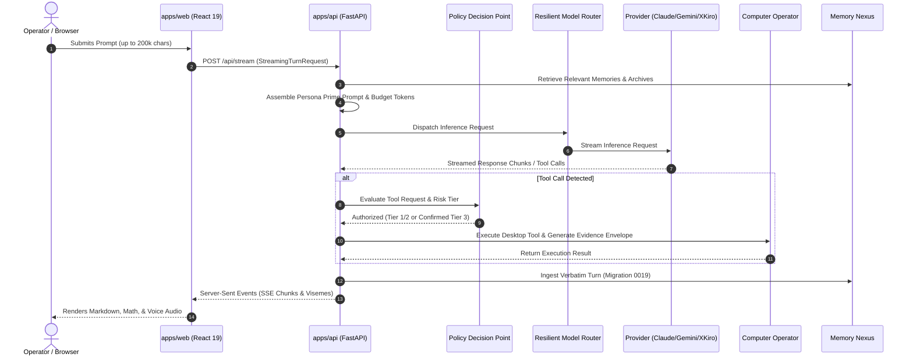

# HINAA OS — REPOSITORY ARCHITECTURE & SUBSYSTEM MAP
**Audit Date:** 2026-11-12  
**Repository Branch:** `main` (commit `643b1dc`)  
**Auditor:** Antigravity Master Engineering & Verification Engine  
**Status:** IMPLEMENTED_AND_VERIFIED  

---

## 1. High-Level Workspace Architecture

HINAA OS is structured as a high-performance monorepo utilizing `pnpm` workspaces for TypeScript packages and an isolated virtual environment (`.venv`) for the Python FastAPI backend.

```
HINAMYGIRL/
├── apps/
│   ├── api/                     # Python 3.14 / FastAPI backend
│   │   ├── hinaa_api/           # Core API package
│   │   │   ├── api/             # Phase 05/06 REST endpoints
│   │   │   ├── routers/         # Domain-specific routers
│   │   │   ├── services/        # Business logic & intelligence engines
│   │   │   ├── persistence/     # SQLite/PostgreSQL & migrations 0001–0019
│   │   │   ├── security/        # PDP, PEP, LoopbackAuth & secrets broker
│   │   │   ├── models/          # Pydantic v2 domain schemas
│   │   │   └── main.py          # Application bootstrap & lifecycle
│   │   ├── tests/               # Backend pytest suites
│   │   └── pyproject.toml       # Poetry/pip dependency manifest
│   └── web/                     # React 19 / Vite 6 / TypeScript frontend
│       ├── src/
│       │   ├── components/      # UI components (ModelSelector, TopBar, etc.)
│       │   ├── services/        # WebAudio, SSE stream, API client
│       │   ├── hooks/           # Custom React hooks
│       │   ├── types/           # Frontend TypeScript interfaces
│       │   └── styles/          # Tailwind CSS & custom design system
│       ├── package.json
│       └── vite.config.ts
├── packages/
│   ├── contracts/               # Protocol schemas & shared contracts
│   └── provider-sdk/            # Unified LLM provider abstractions
├── docs/                        # Architectural documentation & audit reports
├── pnpm-workspace.yaml          # Monorepo workspace configuration
└── package.json                 # Monorepo root configuration
```

---

## 2. Backend Subsystems (`apps/api/hinaa_api`)

### 2.1 Core Routing Layer
- **`main.py`**: Configures FastAPI application, CORS middleware, lifespan events, and mounts all subsystem routers:
  - `/api/chat` & `/api/stream`: Chat turn execution and chunked Server-Sent Events.
  - `/api/personality/profile`: Persona Prime runtime configuration and 10 principles.
  - `/api/memory/archives`: Memory Nexus exact message retention and retrieval.
  - `/api/tools/execute`: Computer Operator execution endpoint guarded by PDP.
  - `/v1/hub`: Integrations hub and external provider bridges.
  - `/api/telemetry`: Latency tracking and pipeline metrics.
  - Domain routers in `routers/`: `loop_router`, `evals_router`, `artifacts_router`, `creative_router`, `voice_router`, `coding_sandbox_router`, `browser_tasks_router`, `agency_router`.

### 2.2 Intelligence & Execution Engines (`services/`)
- **`provider_router.py`**: Resilient multi-provider routing supporting:
  - Mistral AI / Codestral (XKiro lane)
  - Google Gemini 3.5 Flash / Pro (Google lane)
  - Anthropic Claude 3.5 / Opus (Experiential lane)
  - OpenAI / Respan (Respan lane)
  - DeepSeek / Qwen / Local Ollama (Local/Self-hosted lane)
- **`persona_prime.py`**: Enforces `UNFILTERED_DIRECT` personality, anti-cliché filters, and prompt assembly.
- **`memory_nexus.py`**: Verbatim message storage, SHA-256 deduplication, BM25/FTS retrieval, and contradiction superseding.
- **`computer_operator_reality.py`**: 13 desktop inspection and execution tools with tamper-evident Execution Evidence Envelopes.
- **`file_intelligence.py`**: Multi-format document parser (PDF, DOCX, Code, Audio, Video frame extraction via FFmpeg).

### 2.3 Security & Policy Decision Point (`security/`)
- **`pdp.py` (Policy Decision Point)**: Centralized authorization engine evaluating tool risk tiers (Tier 1–4). Strictly blocks unapproved destructive or shell operations.
- **`secrets_broker.py`**: Redacts sensitive API keys, tokens, and credentials from all logs and stream outputs.
- **`loopback_auth.py`**: Protects administrative and internal IPC endpoints by validating localhost loopback signatures.

### 2.4 Persistence Layer (`persistence/`)
- **`database.py`**: Abstract connection pool supporting SQLite with WAL mode enabled and PostgreSQL via asyncpg.
- **`migrations.py`**: 19 discrete database schema migrations:
  - Migrations 0001–0018: Core conversations, sessions, memories, goals, audit ledger.
  - Migration 0019: `exact_message_archives` table for lossless Memory Nexus storage.

---

## 3. Frontend Architecture (`apps/web`)

### 3.1 Key Component Hierarchy
```
AppRoot
├── TopBarV6 (Navigation, ModelSelectorV7, PersonalityDrawer toggle, Audio Status)
├── WorkspaceLayout
│   ├── SidebarNav (Chat, Dashboard, Models, Reports, Vault, Settings)
│   ├── ChatInterface (MessageList, MessageContent [KaTeX + Markdown], InputBar)
│   ├── PersonalityDrawer (Persona Prime profile, mode switcher, live quote preview)
│   └── AvatarCanvas (Three.js WebGL scene, VRM humanoid loader, lip-sync visemes)
└── TelemetryOverlay (Pipeline latency: Intent -> Reason -> Tool -> Avatar -> Render)
```

### 3.2 Responsive & Layout Guardrails
- **Adaptive Breakpoint (`TopBarV6`)**: Automatically hides `.topbar-v6__modes` on screens `<= 1250px`, resolving visual overlap on laptops and mobile devices.
- **Dynamic Stream Decoder**: Ingests chunked SSE payloads without UI freeze, buffering token streams for smooth Markdown rendering.
- **Three.js VRM Runtime**: Isolated in an offscreen or dedicated canvas with WebGL context recovery and clean disposal on route change.

---

## 4. End-to-End Runtime Data Flow



---

## 5. Architectural Health Assessment

The codebase exhibits exceptional modularity, clear separation of concerns, and robust defense-in-depth security principles. Shared contracts guarantee protocol consistency between TypeScript and Python environments.
