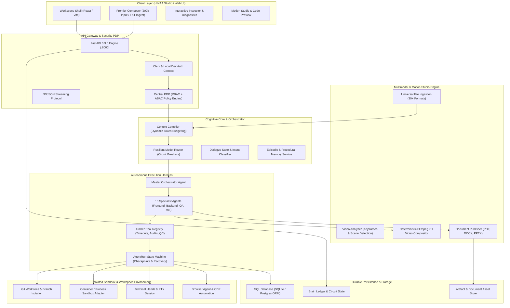
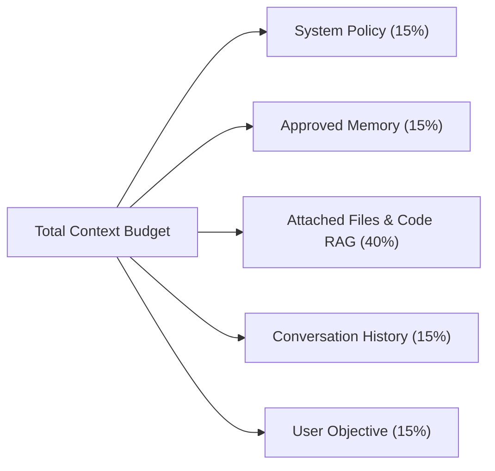
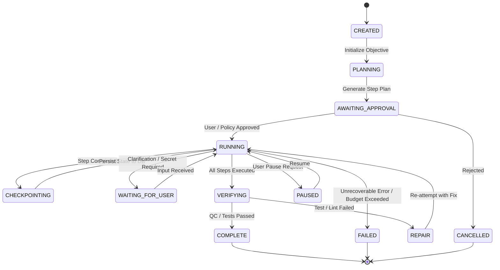
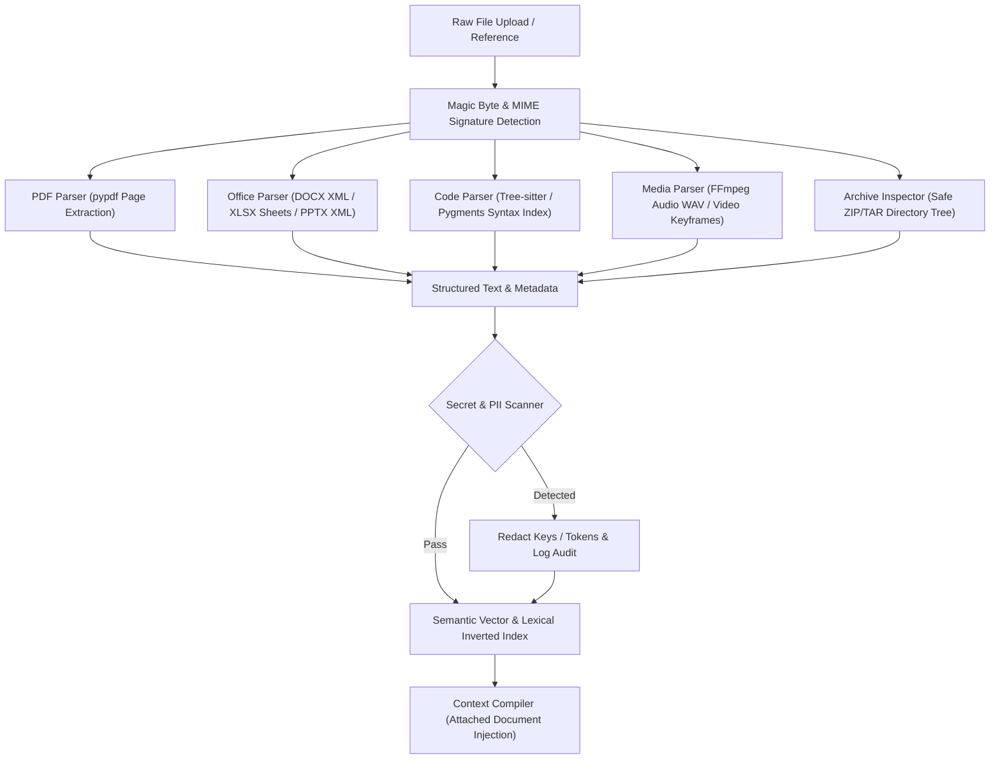
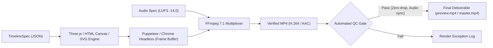
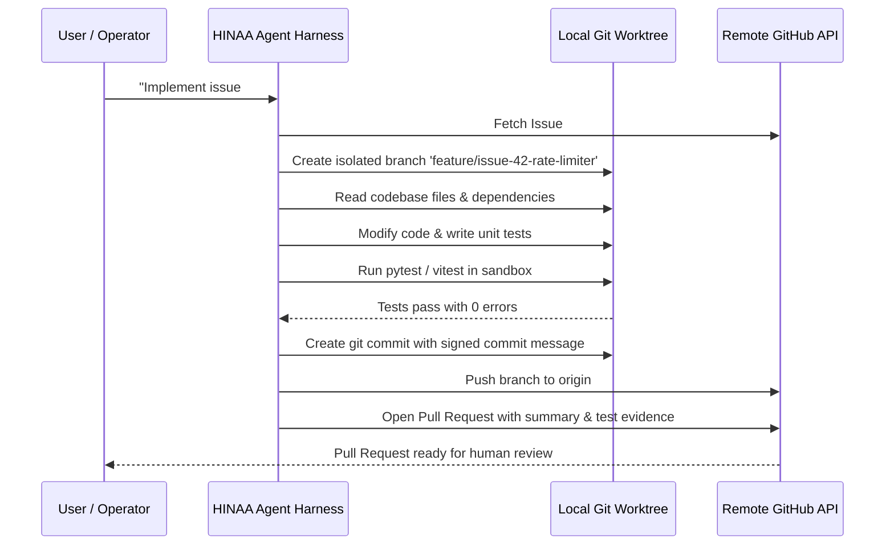

# HINAA OS — PHASE 05 ARCHITECTURE SPECIFICATION
## MASTER AUTONOMOUS INTELLIGENCE AND ENGINEERING OPERATING ENVIRONMENT

**Document ID:** `PHASE_05_ARCHITECTURE`  
**Phase:** 05 — Singularity Evolution  
**Date:** 2026-11-12  
**System Target:** Enterprise Multimodal Autonomous Operating Environment  

---

## 1. END-TO-END SYSTEM TOPOLOGY

---

## 2. ADVANCED COGNITIVE INTELLIGENCE CORE (WORKSTREAM 01)

### 2.1 Dynamic Context Budgeting
Modern frontier models offer vastly different context capacities:
- **Ultra-Long (1M Tokens):** `gemini-3.5-flash` (~4,000,000 characters).
- **Extended (200k Tokens):** `claude-opus-5.5`, `claude-sonnet-4-6` (~800,000 characters).
- **Standard (128k Tokens):** `mistralai/codestral-2508`, `deepseek-v4.1-flash` (~512,000 characters).
- **Local / Edge (8k–32k Tokens):** Local models and fast intent gates.

The `ContextCompiler` dynamically retrieves the active model's token limits and allocates budgets across priority layers:

$$\text{Total Budget} = \text{Model Context Window} - \text{Max Output Tokens} - \text{Safety Margin}$$

### 2.2 Layer Priority & Trusted Delimiters
Content is partitioned by security trust boundaries:
1. **Priority 0 (Trusted Application):** System Persona, Core Safety Rules, Output Contracts.
2. **Priority 5 (Application Verified):** Model Metadata, Capability Flags, Tool Definitions.
3. **Priority 8 (Trusted Application):** Approved Long-Term Memory, Verified User Profile.
4. **Priority 10 (Untrusted Data):** Attached Documents, Web Search Snippets, RAG Chunks.
5. **Priority 15 (Untrusted History):** Prior Conversational Turns.
6. **Priority 20 (Untrusted User Content):** Current User Prompt and Instructions.

Untrusted blocks are strictly wrapped with `<attached_documents trusted="false">` and `<user_message trusted="false">` delimiters to prevent prompt injection from overriding core safety invariants.

---

## 3. AUTONOMOUS AGENT HARNESS & EXECUTION STATE MACHINE (WORKSTREAM 02 & 05)

### 3.1 Durable Agent State Machine

### 3.2 Specialist Agent Hierarchy
1. **Master Orchestrator:** Decomposes macro goals, schedules sub-agent dependencies, monitors token/time budgets, handles user approval requests.
2. **Research Agent:** Performs multi-hop Exa and live web search, summarizes academic papers, collects reference datasets.
3. **Frontend Engineering Agent:** React, Vite, TypeScript, Tailwind, WebGL component development and CSS responsive styling.
4. **Backend Engineering Agent:** FastAPI, Python, database queries, ORM migrations, async background tasks.
5. **Database Agent:** Schema design, SQL index optimization, Alembic migrations, data validation.
6. **Testing and QA Agent:** Pytest, Vitest, Playwright automated testing, regression checking, coverage verification.
7. **Security Review Agent:** Secret scanning, dependency vulnerability audit, authorization boundaries, sanitization checks.
8. **Documentation Agent:** API reference generation, README documentation, architecture diagrams, user manuals.
9. **Creative Director Agent:** Aesthetic design, typography, color palettes, visual mood boards, animation timing sheets.
10. **Media Production Agent:** FFmpeg command synthesis, video keyframe analysis, audio normalization, render job verification.

---

## 4. UNIVERSAL FILE INTELLIGENCE ARCHITECTURE (WORKSTREAM 06)

---

## 5. HINA MOTION STUDIO: OPEN VIDEO ENGINE (WORKSTREAM 07)

### 5.1 Architecture & Stack Choice
To eliminate commercial licensing restrictions associated with proprietary frameworks like Remotion, HINA Motion Studio implements a **fully open, royalty-free composition and rendering architecture**:

### 5.2 Video Reference Understanding Pipeline
When a user uploads a reference video:
1. **Probe Stream:** Inspect resolution, duration, framerate, video/audio codecs via `ffprobe`.
2. **Keyframe Extraction:** Extract scene change frames using `ffmpeg -i video.mp4 -vf "select='gt(scene,0.4)',scale=960:-1" -vsync vfr frames/%04d.png`.
3. **Audio Extraction & Beat Mapping:** Extract 16 kHz WAV audio, estimate BPM and transient beats via signal peak detection.
4. **Reference Package:** Package keyframes, scene timings, color palettes, and motion curves into a structured JSON manifest for model ingestion.

---

## 6. GITHUB-NATIVE INTEGRATION ARCHITECTURE (WORKSTREAM 03)

---

## 7. SECURITY & AUTHORIZATION POLICY (WORKSTREAM 11)

### 7.1 Multi-Tier Action Risk Matrix

| Risk Tier | Classification | Description | Permitted Authorization Source |
|---|---|---|---|
| **Tier 0** | Read-Only | Observation, `system_info`, inspecting directories, reading code | Inherent / Standing Consent |
| **Tier 1** | Reversible | Workspace temp folder creation, local scratch edits | Bounded Workspace Policy |
| **Tier 2** | External | Web navigation, file downloads, external documentation queries | Confirmed User or Scoped Role |
| **Tier 3** | Process Exec | Terminal command execution, process spawning, code evaluation | **Strictly Confirmed User (`approval_source='user'`)** |
| **Tier 4** | Destructive / Irreversible | Git force-push, production deployment, external payments, deletion | **Strictly Authenticated Owner + Explicit Confirmation** |

### 7.2 Core Authorization Invariant
$$\text{Permission Granted} \iff \text{Token Valid} \land \text{User ID Authenticated} \land \text{Role Has Perm}(\text{Action}) \land \neg\text{Emergency Stop}$$

No client-supplied JSON header or query parameter can independently bypass PDP evaluation.
