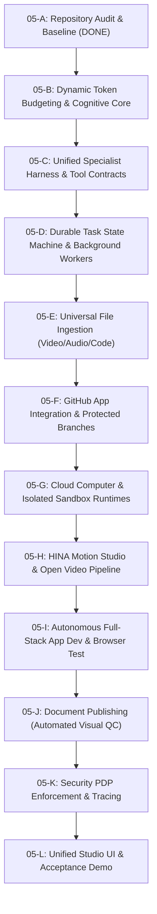

# HINAA OS — PHASE 05 SINGULARITY EVOLUTION ROADMAP
## CONTROLLED IMPLEMENTATION SEQUENCE AND ACCEPTANCE GATES

**Document ID:** `PHASE_05_ROADMAP`  
**Phase:** 05 — Singularity Evolution  
**Date:** 2026-11-12  
**Governance Model:** Incremental, verified work packages with separate logical commits  

---

## 1. IMPLEMENTATION WORK PACKAGE SEQUENCE

---

## 2. DETAILED WORK PACKAGES & ACCEPTANCE CRITERIA

### Package 05-A: Full Source Audit and Architecture Inventory
* **Scope:** Audit git history, verify baseline commits, evaluate critical watchpoints, and establish Phase 05 foundation documents.
* **Deliverables:** `PHASE_05_MASTER_REPORT.md`, `PHASE_05_ARCHITECTURE.md`, `PHASE_05_IMPLEMENTATION_STATUS.md`, `PHASE_05_SECURITY_REVIEW.md`, `PHASE_05_PERFORMANCE_BASELINE.md`, `PHASE_05_TEST_EVIDENCE.md`, `PHASE_05_ROADMAP.md`.
* **Acceptance Gate:** Working tree clean, 99 backend tests passing, 32 web tests passing, production build exit code 0.
* **Status:** `COMPLETED` (Milestone 05-A).

---

### Package 05-B: Dynamic Token Budgeting & Cognitive Context Compilation
* **Scope:** Upgrade `cognitive/context_compiler.py` and `prompts/context.py` to dynamically size context budgets based on the active provider's token limits (`gemini`: 1M, `claude`: 200k, `codestral`: 128k, `local`: 16k). Implement token-aware chunking and hybrid lexical/semantic retrieval.
* **Acceptance Gate:** Automated test verifying that large documents are appropriately budgeted without truncation errors across varying model targets.

---

### Package 05-C: Unified Specialist Agent Harness & Tool Contracts
* **Scope:** Standardize the tool registry (`tools/registry.py`) with uniform schemas: timeout specifications, retry classifications, audit logging, and predictable failure behavior. Define the 10 specialist agent roles with explicit responsibilities.
* **Acceptance Gate:** Harness dispatch tests verifying specialist agent task delegation and idempotent retry handling.

---

### Package 05-D: Durable Task State Machine & Background Workers
* **Scope:** Implement the `AgentRun` state machine (`CREATED` $\rightarrow$ `PLANNING` $\rightarrow$ `RUNNING` $\rightarrow$ `CHECKPOINTING` $\rightarrow$ `VERIFYING` $\rightarrow$ `COMPLETE` / `REPAIR`). Enable durable checkpoint persistence independent of active browser sessions.
* **Acceptance Gate:** Test simulating worker restart during a running job, verifying that execution resumes from the latest valid checkpoint without duplicated work.

---

### Package 05-E: Universal File Intelligence (Audio/Video Frame Extraction & Code Indexing)
* **Scope:** Expand `media/extractors.py` and `resolver.py` with video keyframe extraction via FFmpeg 7.1, audio spectrogram and beat mapping, and syntax-aware code parsing across all 30+ declared file formats.
* **Acceptance Gate:** Automated parsing and metadata verification tests for video (MP4), audio (WAV/MP3), code (TSX/PY), and documents (PDF/DOCX/XLSX).

---

### Package 05-F: GitHub App Integration & Protected Branch Workflows
* **Scope:** Integrate authenticated GitHub App workflows in `tools/github_tools.py`. Support automated branch creation, commit creation, diff inspection, and pull-request generation with least-privilege scoping.
* **Acceptance Gate:** Simulated or staging Git operations demonstrating end-to-end branch creation, code modification, test verification, and pull request summary generation.

---

### Package 05-G: Cloud Computer & Isolated Sandbox Runtimes
* **Scope:** Harden `sandbox/process_adapter.py` and finalize `sandbox/docker_adapter.py` with non-root user execution, strict memory limits, execution timeouts, and network isolation policies.
* **Acceptance Gate:** Sandbox isolation verification ensuring child processes cannot escape designated workspace directories or persist stale state.

---

### Package 05-H: HINA Motion Studio & Open Video Pipeline
* **Scope:** Implement the royalty-free video composition and rendering pipeline using Three.js / HTML Canvas / SVG and host FFmpeg 7.1. Add reference-video scene analysis and audio beat synchronization.
* **Acceptance Gate:** Real rendering of an MP4 deliverable with LUFS -14.0 audio normalization and automated QC verification passing.

---

### Package 05-I: Autonomous Full-Stack Application Scaffolding
* **Scope:** Expand `tools/website_design.py` and `coding_agent_tool.py` to scaffold multi-file full-stack web applications (React + FastAPI), execute automated browser verification via CDP, and self-repair detected lint/runtime errors.
* **Acceptance Gate:** Generation and browser validation of a functional web application with retained screenshots and verified test output.

---

### Package 05-J: Document Publishing Engine (Automated Visual QC)
* **Scope:** Implement automated visual QC for ReportLab PDFs and PPTX presentations, checking page count, image clipping, table formatting, and cross-references.
* **Acceptance Gate:** Generated multi-page PDF validated through automated integrity and visual inspection tests.

---

### Package 05-K: Security PDP Enforcement & Production Observability
* **Scope:** Enforce the Central Policy Decision Point (`security/pdp.py`) across all tool execution routes. Add distributed tracing, Prometheus-compatible metrics, and security audit logs.
* **Acceptance Gate:** Security regression suite confirming zero unauthorized privilege elevations and verifying audit log generation.

---

### Package 05-L: Unified Studio Interface & Final Acceptance Demo
* **Scope:** Connect all Phase 05 subsystems into the HINAA Studio interface (`apps/web/src/shell/`). Maintain responsive design, clean navigation, and observable task execution views.
* **Acceptance Gate:** Complete end-to-end user journey demonstration: repository selection, objective assignment, plan approval, isolated development, test execution, browser verification, and pull request delivery.
