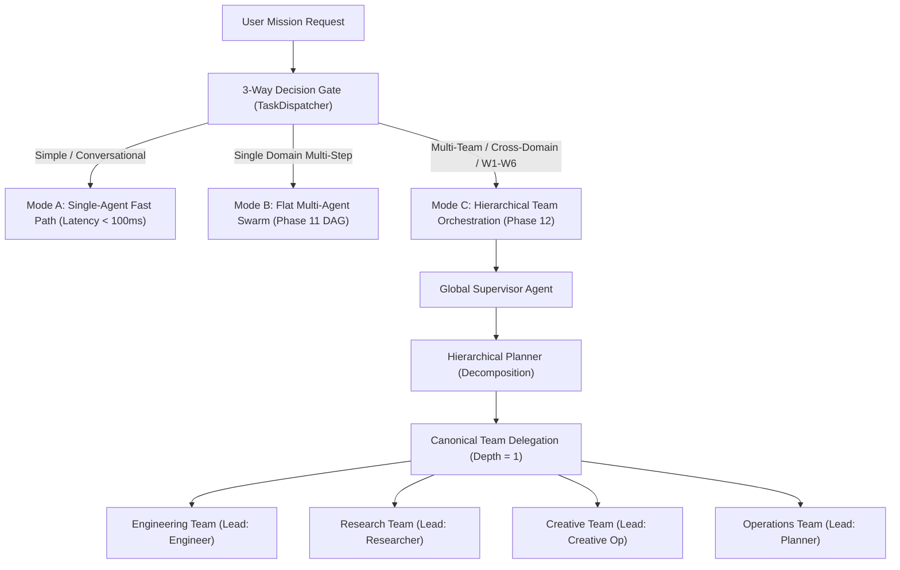
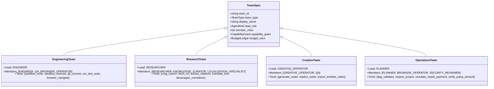

# HINAA OS — Phase 12: Hierarchical Team Orchestration Architecture

**Revision:** 1.0  
**Status:** IMPLEMENTED & VERIFIED  
**Date:** November 5, 2026  
**Module Path:** `apps/api/hinaa_api/agents/`

---

## 1. Executive Summary

Phase 12 evolves HINAA OS from Phase 11's flat multi-agent swarm into a **hierarchical, multi-team orchestrator** designed for complex, long-horizon, cross-domain missions. Rather than running a monolithic flat DAG where all specialist nodes compete for leases and share a single global context, Phase 12 introduces:

1. **3-Way Adaptive Execution Mode:** Automatically routes incoming tasks between `SINGLE_AGENT_FAST_PATH`, `FLAT_MULTI_AGENT`, and `HIERARCHICAL_TEAM` based on semantic triggers, domain count, and computational complexity.
2. **Canonical Team Templates:** Four pre-configured specialist teams (`EngineeringTeam`, `ResearchTeam`, `CreativeTeam`, `OperationsTeam`) composed from the ten canonical Phase 11 specialist roles.
3. **Typed Delegation Packets (`DelegationRequest`):** Scoped objectives, explicit acceptance criteria, input artifact references, and nested budget slices.
4. **Cryptographically Signed Outcomes (`TeamResult`):** Signed outcome packets containing verified postconditions, evidence receipts, cost metrics, scoped summaries, and HMAC-SHA256 signatures.
5. **Context Isolation & Secret Scrubbing:** Context is strictly scoped to each team's subtask; tokens, passwords, and API keys are automatically redacted by `ContextScrubber` during handoff.
6. **Nested Budget Slicing:** Mathematical resource conservation where $\sum \text{child\_budget\_slices} \le \text{parent\_budget}$; unused resources are automatically refunded to the parent ledger upon team completion.
7. **Complete Ancestry Binding in Tier C Approvals:** HMAC-SHA256 approval tokens bind the complete delegation ancestry string (`task > team > node`) to prevent cross-context spoofing or replay attacks.
8. **Independent QA Verification Overrides:** Optimistic developer claims are strictly subordinated to independent QA test exit codes and artifact checksum validation.

---

## 2. 3-Way Adaptive Execution Architecture



### Routing Rules

| Execution Mode | Condition | Overhead | Latency Target |
| :--- | :--- | :--- | :--- |
| **`SINGLE_AGENT_FAST_PATH`** | Direct greetings, simple single-step queries, word count < 10. | Zero DAG allocation, direct specialist response. | < 100 ms |
| **`FLAT_MULTI_AGENT`** | Single domain multi-step workstream (e.g. refactor a single module, single test run). | Flat 3–5 node DAG with shared supervisor. | 100–150 ms |
| **`HIERARCHICAL_TEAM`** | Explicit hierarchical keywords (`"hierarchical"`, `"team"`, `"nested"`), Workflows W1–W6, or $\ge 3$ distinct capability domains (code + research + localization/commerce). | Nested subgraphs, sliced budgets, typed delegation. | 120–250 ms |

---

## 3. Four Canonical Team Templates

All team templates are registered in `SpecialistRegistry` and reuse the 10 canonical specialist roles:



---

## 4. Nested Budget Slicing & Resource Conservation

Parent tasks are assigned a macro-budget. When delegating a subtask to a team lead, the supervisor carves out a slice:

$$\text{Remaining Parent Tokens} = \text{Allocated Tokens} - \text{Consumed Tokens} - \sum \text{Active Child Slices}$$

```python
# Budget Slicing Algorithm in BudgetController
def allocate_slice(self, tokens=8192, tool_calls=15, cost_paisa=5000, seconds=60.0) -> BudgetLedger:
    rem_tokens = max(0, self.ledger.allocated_tokens - self.ledger.consumed_tokens - self._active_allocated_tokens)
    slice_tokens = min(tokens, rem_tokens) if rem_tokens > 0 else min(tokens, self.ledger.allocated_tokens)
    self._active_allocated_tokens += slice_tokens
    ...
```

Upon team outcome delivery, `reconcile_slice()` adds the child's actual consumption to parent totals and frees the unconsumed slice reservation, ensuring zero resource leakage and no integer drift.

---

## 5. Complete Ancestry Binding in Tier C Approvals

To prevent delegation privilege escalation or token replay attacks across nested hierarchies, every Tier C approval request binds the full hierarchical ancestry:

$$\text{Signature} = \text{HMAC-SHA256}(K, \text{ancestry} : \text{tenant} : \text{user} : \text{team} : \text{node} : \text{action} : \text{arg\_digest} : \text{amount\_paisa} : \text{nonce} : \text{expires\_at})$$

```python
# PolicyBridge Ancestry Validation
if ancestry is not None and rec.ancestry != ancestry:
    return False, "ANCESTRY_MISMATCH"
if team_id is not None and rec.team_id != team_id:
    return False, "TEAM_MISMATCH"
```

---

## 6. Independent QA Verification Override Rule

In accordance with strict zero-hallucination engineering principles:

$$\text{Node Status} = \begin{cases} \text{FAILED}, & \text{if } \text{tool\_output.qa\_passed} == \text{False} \lor \text{exit\_code} \ne 0 \\ \text{COMPLETED}, & \text{if } \text{verifier.verify\_node().passed} == \text{True} \end{cases}$$

An engineer's optimistic claim (e.g. `"Code is ready"`) is completely ignored if the independent QA verification node reports exit code $\ne 0$. The supervisor immediately halts task completion and records the verified defect.
