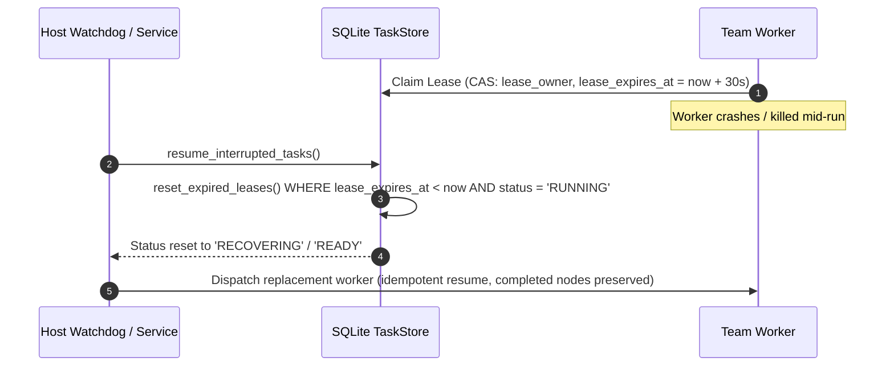

# HINAA OS — Phase 12 Security Boundaries & Crash Recovery

**Revision:** 1.0  
**Status:** CANONICAL POLICY  
**Date:** November 5, 2026  

---

## 1. Security & Capability Governance

Phase 12 enforces defense-in-depth across hierarchical team boundaries:

### A. Role-Based Least Privilege (Capability Whitelisting)
Every specialist node in a team is constrained to its exact capability grant defined in `SpecialistRegistry`:
- **`ENGINEER`:** Can read/write within isolated workspace sandbox (`sandbox_write`, `sandbox_execute`, `git_commit_scoped`), but CANNOT execute browser actions directly or invoke web searches.
- **`RESEARCHER`:** Can search CRAG corpus (`crag_search`, `fetch_url_content`, `extract_citations`), but CANNOT write to disk or commit to git.
- **`QA`:** Can run tests and verify hashes (`run_test_suite`, `verify_file_hash`, `check_exit_code`), but CANNOT modify application code.
- **`BROWSER_OPERATOR`:** Can navigate authorized domains and take screenshots (`browser_navigate`, `browser_screenshot`), but CANNOT commit code or access financial APIs.

### B. Inter-Team Secret Scrubbing
Before any upstream context or delegation request is passed to a team, `ContextScrubber` scrubs:
1. API keys matching `sk-[a-zA-Z0-9_-]{20,}` or `AIza[0-9A-Za-z-_]{35}`.
2. Authorization header strings matching `Bearer [A-Za-z0-9_\-\.]{8,}`.
3. Password fields and private keys in dictionaries and arrays.
All sensitive tokens are drop-in replaced with `[REDACTED_SECRET]` to prevent cross-team credential leakage.

---

## 2. Complete Ancestry Binding in Tier C Approvals

All consequential operations (e.g. Nepali digital wallet simulation, external deploys) require Tier C explicit human authorization. The cryptographic signature binds the complete ancestry chain:

$$\text{HMAC-SHA256}(K, \text{ancestry} : \text{tenant} : \text{user} : \text{team} : \text{node} : \text{action} : \text{arg\_digest} : \text{amount\_paisa} : \text{nonce} : \text{expires\_at})$$

### Attack Mitigations

| Attack Vector | Defense Mechanism | Result |
| :--- | :--- | :--- |
| **Cross-Team Token Hijack** | Signature binds exact `ancestry` and `team_id`. | `TEAM_MISMATCH` or `ANCESTRY_MISMATCH` |
| **Replay Attack** | Single-use UUID nonce stored and marked `used = True`. | `APPROVAL_ALREADY_USED` |
| **Token Tampering** | Parameter and paisa digest re-verified against signature. | `PRICE_AMOUNT_MISMATCH` or `SIGNATURE_INVALID` |
| **Stale Authorization** | Strict 600-second TTL enforced against ISO timestamp. | `APPROVAL_EXPIRED` |

---

## 3. Crash Recovery & Lease Management

In long-horizon missions spanning multiple teams and nested subgraphs, workers or host processes may crash mid-execution. Phase 12 implements atomic lease recovery:

1. **Compare-And-Swap (CAS) Lease Grants:** Worker leases are granted for bounded durations (30 seconds) using atomic SQLite transactions.
2. **Crash Recovery Scan (`reset_expired_leases`):** Scans for nodes with `status = 'RUNNING'` whose `lease_expires_at < now()`. Automatically resets status to `RECOVERING` and clears `lease_owner`.
3. **Idempotent Resumption:** The hierarchical supervisor resumes execution from the exact interrupted node. Completed sibling nodes and upstream verified artifacts are fully preserved without re-execution or duplicate expenditures.

---

## 4. Cascading Emergency Stop

The `PolicyBridge.trigger_emergency_stop()` kill-switch immediately suspends all active execution:
1. `is_stopped()` returns `True` across all service components.
2. Running node execution loops immediately abort with status `CANCELLED` and error code 126.
3. Pending Tier C approval tokens cannot be consumed while emergency stop is engaged.
4. Active leases are released cleanly.
5. Standard governance resumes only upon explicit operator call to `resume_from_emergency_stop()`.
