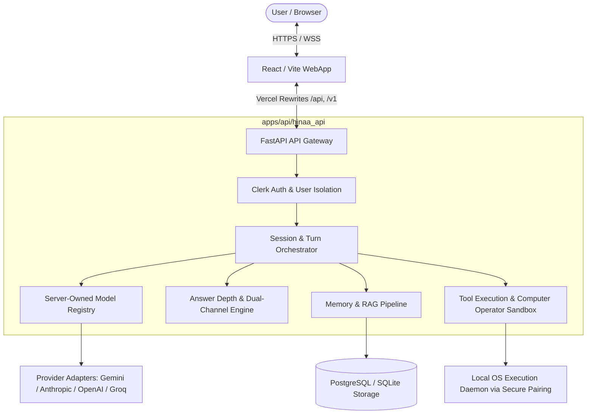

# System Architecture: HNA / HINA Autonomous AI Agent

## 1. High-Level Architectural Overview

HNA / HINA is architected as a robust **modular monolith** consisting of:
1. **Backend Service (`apps/api`)**: A high-performance Python FastAPI service managing authentication, session ownership, agentic turn orchestration, model registry routing, memory/retrieval subsystems, tool execution sandboxes, and realtime streaming.
2. **Frontend Client (`apps/web`)**: A modern React/Vite/TypeScript client featuring a unified multi-modal workspace, Three.js/VRM expressive avatar rendering, WebRTC/WebSocket realtime voice transport, and deterministic Markdown rendering.



---

## 2. Core Subsystems and Boundaries

### 2.1 User Interface & Interaction State
- **State Management**: Centralized store coordinating interaction modes (`WorkMode`, `CompanionMode`, `PresenceMode`).
- **Audio Feedback**: Progressive audio feedback with strict lifecycle gating. Generative teletype sound effects (`playStreamChunkSound`) are strictly gated by active `speaking` and `thinking` states, ceasing immediately upon turn finalization.
- **Rendering Pipeline**: Deterministic Markdown rendering preserving syntax highlighting, code indentation, tables, and evidence citations without destructive post-processing.

### 2.2 Authenticated API & Session Ownership
- **Authentication**: JWT validation powered by Clerk (`apps/api/hinaa_api/auth.py`).
- **Tenant Isolation**: Every database record, session, turn, memory item, and tool invocation is bound to a validated `user_id`. Cross-user access is blocked at the database query boundary.

### 2.3 Dual-Channel Response Engine
To solve the conflict between rich research reports and natural conversational speech:
- **`displayText` Channel**: Full structured output (GFM tables, indented code blocks, multi-level headers, and citations). Preserved in its entirety by default across streaming, persistence, and page reload. Trimming is restricted strictly to voice-collision apologies.
- **`spokenText` Channel**: Concise, conversational speech generated via `plan_voice_response`, designed for natural prosody, low latency, and zero reading out of markdown syntax or large tables.

### 2.4 Model Registry & Routing Architecture
- Centralized server-owned registry (`apps/api/hinaa_api/harness/model_registry.py`).
- Maintains verified operational parameters: context limits, max output tokens, multi-modal capabilities, tool-calling support, and pricing tiers.
- Decouples client requests from hardcoded provider calls, enforcing allowlist policies, circuit breakers, and bounded fallback.

### 2.5 Tool Authorization & Sandboxed Execution
- Strict boundary between cloud orchestration and local device execution (`apps/api/hinaa_api/tools/computer_operator.py`).
- Cloud services cannot execute unauthenticated arbitrary operating system commands.
- Local execution requires an explicitly authenticated local companion daemon, path sandboxing, destructive action approval, and observable state verification.

---

## 3. Typed Data Contracts

```typescript
// Core Turn & Event Contracts
interface TurnRequest {
  conversationId: string;
  turnId: string;
  userId: string;
  input: {
    type: 'text' | 'audio' | 'multimodal';
    content: string;
    mediaUrls?: string[];
  };
  requestedModel?: string;
  providerPreference?: string;
}

interface TurnEvent {
  turnId: string;
  sequenceId: number;
  type: 'chunk' | 'tool_call' | 'tool_result' | 'voice_chunk' | 'final' | 'interrupted' | 'error';
  payload: {
    displayTextDelta?: string;
    spokenTextDelta?: string;
    audioBase64?: string;
    toolCall?: ToolCall;
    error?: string;
  };
  timestamp: number;
}

interface ToolCall {
  callId: string;
  name: string;
  parameters: Record<string, unknown>;
  requiresApproval: boolean;
  status: 'planned' | 'authorized' | 'executing' | 'completed' | 'failed';
}

interface ToolResult {
  callId: string;
  output: unknown;
  observableEvidence?: string;
  durationMs: number;
  isError: boolean;
}

interface EvidenceReference {
  sourceId: string;
  title: string;
  url?: string;
  snippet: string;
  confidenceScore: number;
}
```

---

## 4. Execution Data Flow

1. **User Request**: User sends text or voice input. The client sends a `TurnRequest` with JWT credentials.
2. **Authentication & Policy**: Backend validates user identity, checks rate limits, and resolves session state.
3. **Model Selection**: Registry selects the primary model or executes authorized fallback based on capability and health.
4. **Context Assembly**: Memory and retrieval pipelines fetch relevant episodic memories and authorized documents.
5. **Streaming Synthesis**: The model streams tokens. The orchestrator separates `displayText` for immediate UI rendering and streams `spokenText` to the TTS / audio pipeline.
6. **Tool Invocation (if needed)**: Schema-validated tool calls execute within sandboxed boundaries; evidence is collected and injected back into the synthesis loop.
7. **Idempotent Finalization**: Full structured content is saved to PostgreSQL/SQLite, audio buffers flush, and teletype sounds terminate cleanly.
