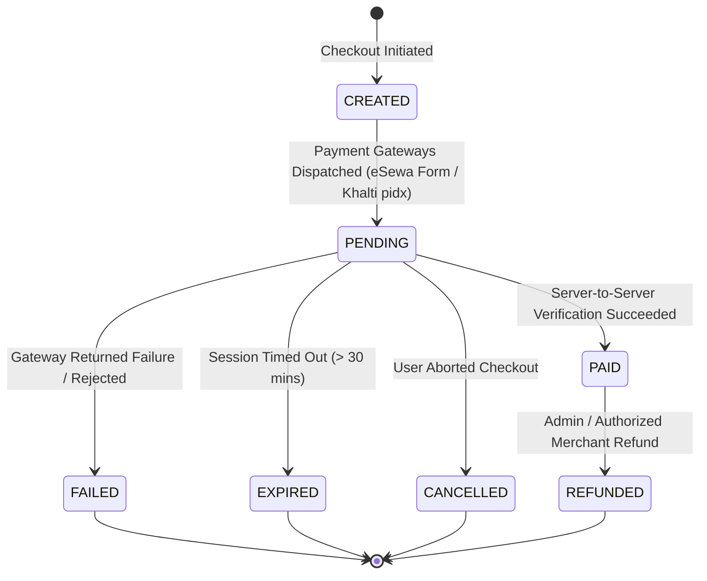

# HINAA OS — Nepal Local Payment Integration Specification (eSewa & Khalti)

**Version**: 1.0.0  
**Date**: November 2026  
**Status**: Authoritative Commerce Architecture & Integration Guide  
**Security Boundary**: Merchant Sandbox Testing Only. Production Live Transactions Strictly BLOCKED without Merchant KYC Approval.  

---

## 1. Executive Summary & Policy Boundary

To enable monetization for Nepali users and businesses, HINAA OS integrates with Nepal's two leading payment service providers (PSPs): **eSewa** and **Khalti**.

### Crucial Safety Principles
1. **User-Authorized Monetization**: Payment flows are strictly for customer checkout (subscriptions, token packages, compute credits). **HINAA is forbidden from initiating payments, transfers, or spending money autonomously.**
2. **Server-Side Verification**: No order is marked as `PAID` based solely on client-side browser redirects or URL query strings. All transactions require direct server-to-server cryptographic verification.
3. **Integer Minor Units (Paisa)**: Currency calculations must use integers representing minor units (1 NPR = 100 paisa). Binary floating-point math (`float`) is strictly prohibited for monetary values to prevent rounding drift.
4. **Credential Isolation**: Merchant secret keys (`ESEWA_SECRET_KEY`, `KHALTI_SECRET_KEY`) reside exclusively in server-side environment variables and are never exposed to browser frontends, LLM prompts, or client artifacts.

---

## 2. Order Lifecycle State Machine



### Order States
- `CREATED`: Order record persisted in database with unique `order_id` and minor unit `amount_paisa`.
- `PENDING`: Payment gateway session active; user redirected to hosted gateway portal.
- `PAID`: Transaction status confirmed via authoritative PSP status API; user entitlements granted atomically.
- `FAILED`: Payment rejected by PSP or signature mismatch detected.
- `EXPIRED`: User did not complete checkout within the bounded time window.
- `CANCELLED`: Explicit cancellation signal received.
- `REFUNDED`: Reversal processed with audit receipt.

---

## 3. eSewa Integration Protocol (ePay v2)

### 3.1 Overview
eSewa requires a signed HTML form POST redirecting the user to the eSewa portal, followed by server-side transaction status lookup.

- **Sandbox Checkout URL**: `https://rc-epay.esewa.com.np/api/epay/main/v2/form`
- **Sandbox Status Verification URL**: `https://uat.esewa.com.np/api/epay/transaction/status/`
- **Production Status URL**: `https://epay.esewa.com.np/api/epay/transaction/status/`

### 3.2 HMAC-SHA256 Signature Generation
Before redirecting the user, HINAA's backend signs the transaction payload using the merchant secret key:
```python
import hmac
import hashlib
import base64

def generate_esewa_signature(secret_key: str, total_amount: str, transaction_uuid: str, product_code: str) -> str:
    # Parameter order required by eSewa documentation:
    message = f"total_amount={total_amount},transaction_uuid={transaction_uuid},product_code={product_code}"
    signature = hmac.new(
        secret_key.encode("utf-8"),
        message.encode("utf-8"),
        hashlib.sha256
    ).digest()
    return base64.b64encode(signature).decode("utf-8")
```

### 3.3 Server-to-Server Transaction Verification
When the user returns to `success_url`, the backend queries eSewa's transaction status endpoint:
```http
GET /api/epay/transaction/status/?product_code={product_code}&total_amount={total_amount}&transaction_uuid={transaction_uuid}
```
**Verification Checks**:
1. HTTP Response `status == 200` and JSON payload `status == "COMPLETE"`.
2. Returned `total_amount` matches the database order amount exactly.
3. Returned `transaction_uuid` matches the existing order in `PENDING` state.
4. Transaction reference code recorded in billing audit ledger.

---

## 4. Khalti Integration Protocol (ePayment v2)

### 4.1 Overview
Khalti's ePayment flow operates via a merchant-side REST API initiation that generates a payment session (`pidx`) and a hosted checkout URL.

- **Sandbox Base URL**: `https://dev.khalti.com/api/v2/`
- **Production Base URL**: `https://khalti.com/api/v2/`

### 4.2 Step 1: Payment Initiation
Backend executes a server-to-server POST to `/epayment/initiate/`:
```http
POST /api/v2/epayment/initiate/ HTTP/1.1
Host: dev.khalti.com
Authorization: Key {KHALTI_SECRET_KEY}
Content-Type: application/json

{
    "return_url": "https://hinaa.ai/checkout/khalti/callback",
    "website_url": "https://hinaa.ai",
    "amount": 100000,
    "purchase_order_id": "ORD-20261105-001",
    "purchase_order_name": "HINAA Plus Monthly Membership",
    "customer_info": {
        "name": "Suman Sharma",
        "email": "suman@example.np",
        "phone": "9800000000"
    }
}
```
*Note: `amount: 100000` represents NPR 1,000.00 (in paisa).*

**Response**:
```json
{
    "pidx": "b8aK9Hk3LqP2zW87",
    "payment_url": "https://test-pay.khalti.com/?pidx=b8aK9Hk3LqP2zW87",
    "expires_at": "2026-11-05T05:30:00Z",
    "expires_in": 1800
}
```

### 4.3 Step 2: Verification Lookup
When the user completes payment on Khalti's portal and returns to `return_url?pidx=b8aK9Hk3LqP2zW87`, HINAA's backend immediately calls the lookup API:
```http
POST /api/v2/epayment/lookup/ HTTP/1.1
Host: dev.khalti.com
Authorization: Key {KHALTI_SECRET_KEY}
Content-Type: application/json

{
    "pidx": "b8aK9Hk3LqP2zW87"
}
```

**Verification Checks**:
1. Returned JSON `status == "Completed"`.
2. `total_amount` (in paisa) strictly matches the order's expected `amount_paisa`.
3. `purchase_order_id` matches the recorded database `order_id`.
4. Idempotency check: Ensure the order is not already marked as `PAID`.

---

## 5. Security & Anti-Fraud Controls

1. **Replay & Idempotency Protection**: Every payment initiation and verification is tracked by unique UUIDs. Duplicate webhook requests receive cached responses without re-executing credit assignments.
2. **Tamper Prevention**: Mismatched currency amounts, unexpected product codes, or altered callback query strings immediately transition the order to `FAILED` with an alert logged to `apps/data/audit/security.log`.
3. **Environment Segregation**:
   - `KHALTI_ENVIRONMENT = "sandbox"` (default)
   - `ESEWA_ENVIRONMENT = "sandbox"` (default)
   - Production flags require explicit merchant verification checklist sign-off.
4. **Zero Wallet Credential Retention**: HINAA never asks for, processes, or stores user eSewa passwords, Khalti MPINs, or OTPs. All credential entry occurs exclusively within the PSP's official hosted domains.

---

## 6. Merchant Onboarding & Go-Live Checklist

To transition from Sandbox to Production:
- [ ] Registered Nepali Entity (Company Registration Certificate / PAN / VAT).
- [ ] Bank Account in a licensed Class 'A' Commercial Bank in Nepal.
- [ ] Signed Merchant Agreement with eSewa (Fonepay / eSewa Pvt. Ltd.).
- [ ] Signed Merchant Agreement with Khalti (Sparrow Pay Pvt. Ltd.).
- [ ] Production API Credentials issued and injected via secure vault (`ESEWA_PRODUCT_CODE`, `ESEWA_SECRET_KEY`, `KHALTI_LIVE_SECRET_KEY`).
- [ ] Bounded End-to-End Live Transaction Smoke Check (e.g., NPR 10 test transaction with automated reversal).
