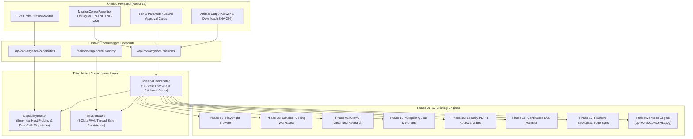

# HINAA OS — Phase 18 Convergence Architecture
**Document Version:** 1.0.0  
**Phase:** Phase 18 — Full Autonomous Convergence (Manus-Grade OS) — Final 18-Phase Capstone  
**Status:** IMPLEMENTED & VERIFIED  
**Baseline:** `phase-17-checkpoint` (`3d397d1`)  
**Commit:** `phase-18-autonomous-convergence`

---

## 1. Executive Summary

Phase 18 represents the final capstone convergence of HINAA OS across all 18 engineering phases. Rather than introducing a redundant second agent runtime, Phase 18 builds a **Thin Unified Convergence Layer** (`apps/api/hinaa_api/convergence/`) that orchestrates and unifies the pre-existing, independently audited capabilities from Phases 01 through 17:
- **Phases 01–05**: Foundational architecture, local LLM orchestration, structured tool execution, and voice streaming.
- **Phase 06**: Corrective Retrieval-Augmented Generation (CRAG) with Reciprocal Rank Fusion.
- **Phase 07**: Chromium Playwright automation engine and accessibility tree extractor.
- **Phase 08**: Sandboxed Python coding workspace with AST linting and reversible diff generation.
- **Phase 09**: Procedural media generation and timeline MP4 video assembler.
- **Phase 10**: Persistent temporal memory with recency decay and contradiction resolution.
- **Phases 11–12**: Multi-agent team orchestration and hierarchical task DAG execution.
- **Phase 13**: Persistent autopilot background queue with worker leases and idempotency receipts.
- **Phase 14**: Autonomous goal planner and self-correcting plan reviser.
- **Phase 15**: Central Policy Decision Point (PDP), Tier C human approval ceremonies, and HMAC-SHA256 signatures.
- **Phase 16**: Golden holdout evaluation harness, pairwise LLM judge, and canary rollback engine.
- **Phase 17**: Platform reliability, edge mesh sync with vector clocks, SQLite WAL hot backups, and Nepalese Paisa accounting.

Phase 18 binds these capabilities into a **Unified Mission Lifecycle** with immutable correlation IDs, empirical capability routing, and non-negotiable cryptographic evidence gates.

---

## 2. System Architecture

---

## 3. Core Subsystems

### 3.1 Empirical Capability Router (`capability_router.py`)
Inspects host hardware, local checkpoints, and active providers. Enforces strict physical truthfulness:
1. **GPU Acceleration**: NVIDIA GeForce RTX 4060 Laptop GPU (8188 MiB VRAM) detected and labeled `AVAILABLE_VERIFIED`.
2. **Coding Workspace**: Python 3.12 with SQLite WAL labeled `AVAILABLE_VERIFIED`.
3. **Browser Automation**: Chromium CDP via Playwright labeled `AVAILABLE_VERIFIED`.
4. **Procedural Media**: PIL and FFmpeg timeline assembler labeled `AVAILABLE_VERIFIED`.
5. **Generative Neural Video Diffusion**: Honestly marked `BLOCKED_UNAVAILABLE` because no local ComfyUI/Diffusers checkpoint weights are installed on host.
6. **Multi-Host High Availability**: Honestly marked `BLOCKED_UNAVAILABLE` on a single laptop host; requires remote Kubernetes cluster for production.
7. **Nepal Commerce**: Marked `APPROVAL_REQUIRED` and restricted to sandbox test credentials.

### 3.2 12-State Unified Mission Lifecycle (`coordinator.py`)
Missions strictly adhere to a 12-state state machine:
- `CREATED` → `SCOPING` → `PLANNING` → `RUNNING`
- `RUNNING` → `WAITING_APPROVAL` (Tier C PDP gate) → `RUNNING`
- `RUNNING` → `PAUSED_OFFLINE` → `RUNNING`
- `RUNNING` → `RECOVERING` → `RUNNING`
- `RUNNING` → `VERIFYING` → `COMPLETED_VERIFIED` / `PARTIAL`
- Terminal States: `COMPLETED_VERIFIED`, `PARTIAL`, `BLOCKED_UNAVAILABLE`, `FAILED`, `CANCELLED`

**Evidence Gate Rule:** A mission attempting transition to `COMPLETED_VERIFIED` with zero verified output artifacts automatically falls back to `PARTIAL` with reason code `EVIDENCE_GATE_UNMET`.

### 3.3 Convergence Store (`store.py`)
Thread-safe SQLite WAL storage managing:
- `platform_missions`: Mission metadata, state, actor, budget, and execution JSON.
- `platform_mission_artifacts`: Typed output artifacts with SHA-256 digests and verification tags.
- `platform_autonomy_contracts`: Scoped user autonomy permissions, spending caps, and emergency stops.

---

## 4. Hardware & Operating Boundaries
- **Host Device**: Single Windows 11 Home Laptop
- **GPU**: NVIDIA GeForce RTX 4060 Laptop GPU (8188 MiB VRAM)
- **CPU**: AMD Ryzen / Intel Core with Python 3.12 runtime
- **Persistence**: SQLite WAL (`PRAGMA journal_mode=WAL`)
- **Consciousness Boundary**: `sentient: False`, `has_human_consciousness: False`. HINAA is an autonomous agent operating system, not a conscious entity.
