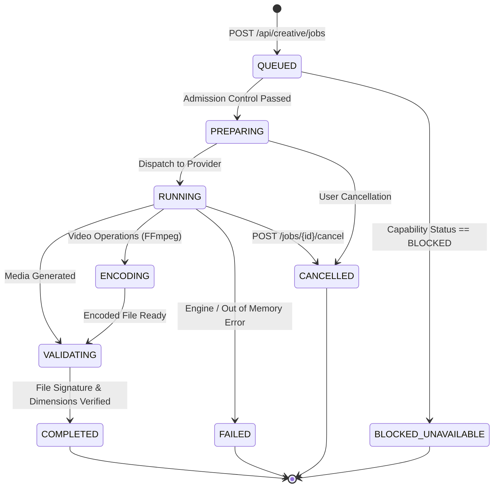

# HINAA OS — Phase 09: Multimodal Intelligence & Creative Studios Architecture

## 1. Executive Summary

Phase 09 evolves HINAA OS into a multimodal creative production environment spanning raster generation, mathematical inpainting, and deterministic timeline-to-video encoding, integrated directly with HINAA's cognitive memory, voice, browser, and developer workspace.

In strict adherence to the **Anti-Gravity Evidence Standard**, this architecture establishes an honest boundary between:
1. **Locally Active Capabilities**:
   - `TEXT_TO_IMAGE` (Local procedural/neural raster synthesis with Nepali Devanagari text rendering).
   - `IMAGE_TO_IMAGE` (Local transform and color space normalization).
   - `INPAINT` (Mathematical mask-based boundary inpainting via OpenCV Telea & Navier-Stokes algorithms).
   - `REMOVE_BACKGROUND` (Otsu contour isolation and RGBA alpha extraction).
   - `TIMELINE_EXPORT` (Deterministic timeline-to-video compilation to H.264 MP4 / WebM via local FFmpeg 7.1).
2. **Truthfully Blocked / Config-Required Capabilities**:
   - `TEXT_TO_VIDEO` and `IMAGE_TO_VIDEO` are classified as **`BLOCKED`** because local diffusion video weights (e.g. SVD, CogVideo) are uninstalled, and external paid video APIs are disabled (`MAGNIFIC_VIDEO_GENERATION_ENABLED=false`).
   - `OUTPAINT` is marked **`CONFIG_REQUIRED`** pending specialized outpaint canvas checkpoints.
   - Any attempt to substitute mock previews, CSS animations, or stock URLs as generative results is strictly prohibited and fails closed.

---

## 2. State Machine & Task Lifecycle

The creative engine uses an authoritative 11-state lifecycle with persistent storage and monotonic SSE sequence tracking:

### Event Sequence Guarantees
- Every transition emits a typed `CreativeEvent` over Server-Sent Events (`GET /api/creative/jobs/{id}/events`).
- Events include monotonic integer `sequence_id` fields, enabling disconnected clients to reconnect with `last_sequence_id` and backfill missed telemetry without repeating terminal events.

---

## 3. Hardware & Runtime Topology

| Subsystem | Discovered State | Security & Operational Policy |
| :--- | :--- | :--- |
| **GPU / VRAM** | NVIDIA GeForce RTX 4060 Laptop GPU (8188 MB VRAM, 4851 MB Free) | Monitored via `nvidia-smi`; admission guard refuses allocations if free VRAM < 2000 MB. |
| **Host Python** | Python 3.14.4 + PyTorch 2.14.1 (CPU wheel) | Local CPU raster processing and OpenCV execution. |
| **Media Encoder** | FFmpeg 7.1 Essentials (`imageio_ffmpeg` binary) | Hardware-isolated subprocess encoding H.264 / AAC video containers. |
| **ComfyUI** | Offline (`http://127.0.0.1:8188` unreachable) | Accurately reported as `OFFLINE`; routes fall back safely to `local_engine`. |
| **External APIs** | Freepik/Magnific (`FREEPIK_API_KEY` present) | Key scrubbing enforced; paid video generation hard-disabled by policy. |

---

## 4. Asset Storage & Tenant Boundary Control

Assets are managed by `CreativeAssetManager` (`apps/api/hinaa_api/creative/assets/manager.py`):
1. **Tenant Isolation**: Files reside under `DATA_DIR/creative_assets/<tenant_id>/<asset_id>_<filename>`. Cross-tenant retrieval raises `HinaaError("ACCESS_DENIED", status_code=403)`.
2. **Path Traversal Shield**: Filenames are sanitized, stripping `..`, slashes, null bytes, and non-printable control characters while fully preserving Unicode and Devanagari script (`नेपाली`).
3. **Magic Byte Verification**: Stored files are validated using binary file signatures (`89 50 4E 47` for PNG, `FF D8 FF` for JPEG, `ftyp` for MP4, `1A 45 DF A3` for WebM). Corrupt byte arrays are rejected.
4. **Non-Destructive Lineage**: When inpainting or generating variations, the parent asset remains byte-identical. Child assets record `parent_asset_id` and increment `version_index` ($v_1 \to v_2 \to v_3$).

---

## 5. API Contracts

| Route | Method | Purpose |
| :--- | :--- | :--- |
| `/api/creative/capabilities` | `GET` | Hardware, VRAM, and honest capability status matrix. |
| `/api/creative/jobs` | `POST` | Job submission with idempotency key deduplication. |
| `/api/creative/jobs/{id}` | `GET` | Lifecycle status, telemetry, and output asset references. |
| `/api/creative/jobs/{id}/events`| `GET` | Real-time Server-Sent Events (SSE) telemetry stream. |
| `/api/creative/jobs/{id}/cancel`| `POST` | Idempotent worker termination and state persistence. |
| `/api/creative/jobs/{id}/retry` | `POST` | Safe retry respecting original spec and retry ceilings. |
| `/api/creative/assets/upload` | `POST` | Scoped media upload with MIME type and signature verification. |
| `/api/creative/assets/{id}` | `GET` | Asset metadata and provenance record. |
| `/api/creative/assets/{id}/download` | `GET` | Full-resolution asset download with `Content-Disposition` and `nosniff`. |
| `/api/creative/assets` | `GET` | Paginated owned gallery of images and videos. |
