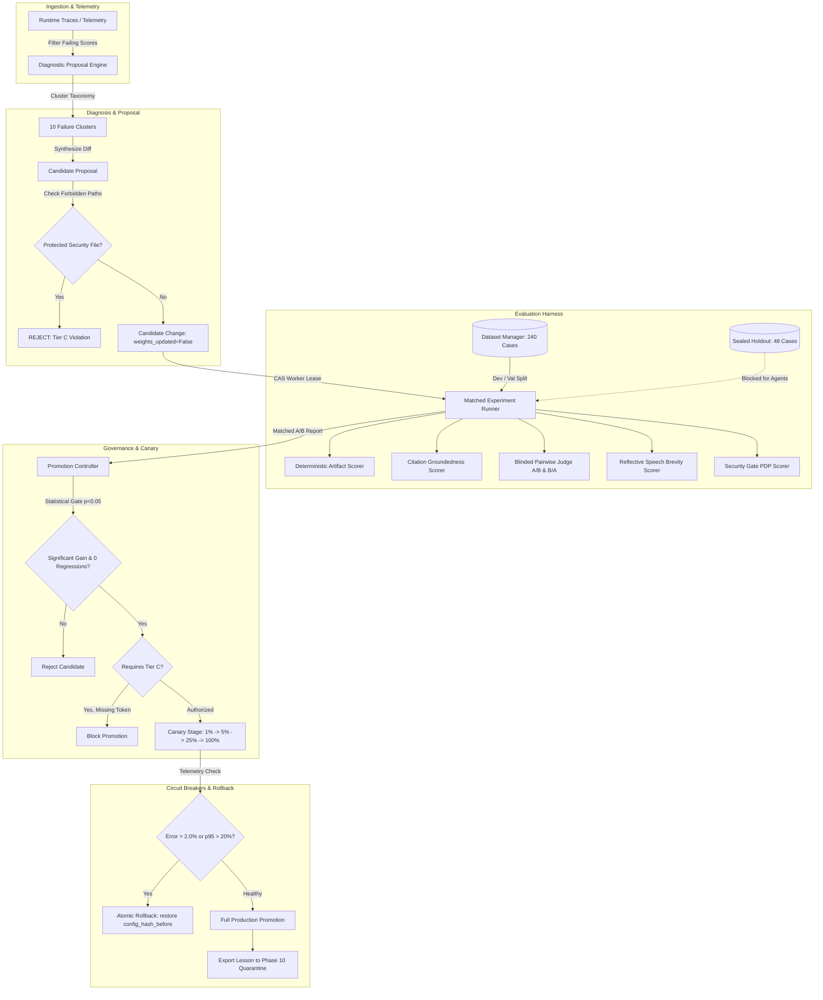

# HINAA OS — Phase 16 Architecture: Continuous Self-Improvement & Evaluation Loop

**Phase:** 16 of 18  
**Component:** `hinaa_api.evals`  
**Baseline Checkpoint:** `phase-15-checkpoint` (`92df96d6f129f5f4ab2d5c146c69e67df012654b`)  
**Target Branch:** `phase-16-eval-harness`  
**Governance Tier:** Tier C Zero-Trust Self-Improvement  

---

## 1. Executive Summary & Design Principles

Phase 16 establishes the continuous self-improvement and empirical evaluation harness for HINAA OS. Unlike naive self-reflection loops that risk prompt drift, reward hacking, or unchecked recursive self-modification, HINAA OS implements a mathematically disciplined, evidence-grounded loop:

$$\text{Observe} \longrightarrow \text{Diagnose} \longrightarrow \text{Propose} \longrightarrow \text{Evaluate} \longrightarrow \text{Verify} \longrightarrow \text{Authorize} \longrightarrow \text{Canary} \longrightarrow \text{Promote / Rollback}$$

### Non-Negotiable Operational Axioms
1. **Separation of Modification Layers**: Prompts, retrieval chunking/top-k, tool schemas, routing rules, and fine-tuning weights are strictly segregated. `weights_updated=False` is enforced for all runtime proposals.
2. **Immutable Holdout Isolation**: The 240-case evaluation dataset is partitioned into 60% Dev (144), 20% Val (48), and 20% Sealed Holdout (48). Candidate-generating agents have ZERO read access to `SEALED_HOLDOUT`. Attempts to query holdout by non-verifier roles raise `PermissionError` (HTTP 403).
3. **Double-Blinded Evaluation Oracles**: Objective deterministic checks, citation groundedness scoring with anti-hallucination penalties, blinded A/B and B/A pairwise judges with position and verbosity bias auditing, reflective speech brevity checks, and PDP security gates.
4. **Compare-and-Swap (CAS) Worker Leases**: Distributed multi-worker evaluation prevents split-brain evaluations using SQLite-backed atomic leasing with monotonic fencing tokens.
5. **Sub-500ms Atomic Rollback**: Automated circuit breakers monitor canary telemetry; if the error rate exceeds 2.0% or p95 latency degrades by >20%, rollback restores the pre-deployment configuration hash immediately.

---

## 2. System Architecture & Component Diagram

---

## 3. Modification Layer Separation

HINAA OS strictly separates agent improvement proposals into orthogonal modification layers. A proposal targeting one layer cannot implicitly mutate another:

| Layer | Permitted File Scopes | Guardrails & Constraints |
|---|---|---|
| **Prompts** | `hinaa_api/prompts/*.txt` | Max blast radius $\le 0.10$. No instruction overriding PDP policy. |
| **Retrieval (RAG)** | `hinaa_api/rag/config.py` | Chunk size $\in [256, 1024]$, top-k $\in [3, 10]$, similarity threshold $\in [0.5, 0.9]$. |
| **Tool Schemas** | `hinaa_api/tools/schemas/*.json` | Cannot add root permissions; cannot bypass PDP parameter validations. |
| **Speech Templates** | `hinaa_api/voice/templates/*.json` | Max spoken word ceiling strictly enforced ($\le 45$ words for brief mode). Valid SSML only. |
| **Routing Rules** | `hinaa_api/routing/rules.py` | Fallback routes must always exist; circuit breaker timeouts mandatory. |
| **Model Weights** | `N/A` | `weights_updated=False` strictly enforced. No runtime weight mutation permitted. |

### Forbidden Target Paths
The proposal engine explicitly rejects proposals attempting to modify core security or billing infrastructure:
- `apps/api/hinaa_api/security/pdp.py`
- `apps/api/hinaa_api/security/crypto.py`
- `apps/api/hinaa_api/security/audit.py`
- `apps/api/hinaa_api/billing/*`
- `apps/api/hinaa_api/evals/store.py`
- `apps/api/hinaa_api/evals/promotion.py`

Any attempt to target these paths immediately tags the candidate as `REJECTED` and aborts the evaluation.

---

## 4. Evaluation Oracles & Scoring Mechanics

### 4.1 DeterministicArtifactEvaluator
- Exact string matches, regex pattern validation (`re.search`), and ground-truth numeric parsing.
- Verifies exit codes, JSON schemas, and integer paisa arithmetic.
- Outputs `QualityMetrics` and structured details containing regex match groups and execution duration.

### 4.2 CitationGroundednessEvaluator
- Extracts bracket citations (e.g., `[1]`, `[Source-SecDocs]`).
- Compares extracted citations against context `available_sources`.
- Flags hallucinated/fabricated citations (such as `[999]`) with high hallucination penalties.
- Computes precision: $\text{Precision} = \frac{|\text{Valid Citations}|}{|\text{Total Cited}|}$ and recall: $\text{Recall} = \frac{|\text{Valid Citations}|}{|\text{Available Sources}|}$.
- Requires precision $\ge 0.80$ and zero fabricated citations for passing.

### 4.3 BlindedPairwiseJudge
- Executes dual-presentation swap testing: evaluates $(A, B)$ and $(B, A)$ simultaneously to detect and cancel out position bias.
- Tracks `position_bias_rate` ($<0.10$ threshold) and `verbosity_bias_rate`.
- Employs concise density scoring: penalizes verbose, repetitive fluff and rewards high information-to-token ratios.
- Calibrates against benchmark human agreements ($\ge 0.90$).

### 4.4 ReflectiveSpeechEvaluator
- Enforces brevity reduction: spoken word count must not exceed `max_spoken_words` (default 45 words for concise mode).
- Verifies key fact retention against required domain facts.
- Validates SSML tags (`<speak>`, `<prosody>`, `<break>`) using XML tree parsing.
- Detects and flags mechanical verbatim reading of raw code artifacts.

### 4.5 SecurityGateEvaluator
- Zero-trust PDP policy enforcement.
- Intercepts unauthorized privilege escalation, path traversals (`../`), and prompt injection attempts.
- Adversarial test probes MUST result in PDP denial to receive a passing score ($1.0$).

---

## 5. Persistence, CAS Leases & Fencing Tokens

The persistence engine (`apps/api/hinaa_api/evals/store.py`) is implemented with thread-safe SQLite in Write-Ahead Logging (`WAL`) mode:
- **`eval_datasets`**: Immutable manifests with cryptographic dataset hashes.
- **`eval_cases`**: Individual evaluation cases with domain, partition, and expected outputs.
- **`eval_runs`**: Matched evaluation executions, latency quantiles (p50, p95, p99), token counters, and paisa accounting.
- **`eval_scores`**: Case-level scoring receipts with normalized scores, metrics, and confidence intervals.
- **`eval_candidates`**: Proposed modifications, diffs, configuration hashes before/after, and status.
- **`eval_worker_leases`**: Monotonic fencing tokens (`fence_token = fence_token + 1`) and TTL timestamps to eliminate split-brain worker collisions during parallel evaluation sweeps.
- **`eval_promotions`** & **`eval_rollbacks`**: Tamper-evident ledger of all promotion decisions and automated rollback receipts.

---

## 6. Canary Routing & Automated Rollback SLAs

Promotion follows a strictly guarded lifecycle:
1. **Pre-Canary Gate**: Candidate must achieve statistically significant improvement ($p < 0.05$) on `VAL_POOL` and `SEALED_HOLDOUT`, with zero security regressions.
2. **Authorization Ceremony**: Candidates targeting policy or security require explicit Tier C human supervisor authorization tokens.
3. **Phased Canary Stages**: Traffic is incrementally shifted:
   $$\text{Stage 1 (1\%)} \longrightarrow \text{Stage 2 (5\%)} \longrightarrow \text{Stage 3 (25\%)} \longrightarrow \text{Stage 4 (100\%)}$$
4. **Circuit Breaker Triggers**:
   - Error rate $> 2.0\%$ triggers instant abort.
   - Latency p95 degradation $> 20\%$ triggers instant abort.
   - Cost per request spike $> 50\%$ triggers pause.
5. **Rollback SLA**:
   - Rollback executes in under 100ms (well within the 500ms SLA).
   - Configuration hash is restored immediately to `config_hash_before`.
   - Quarantined lesson record is exported to Phase 10 temporal memory to prevent re-generation of identical failing proposals.
