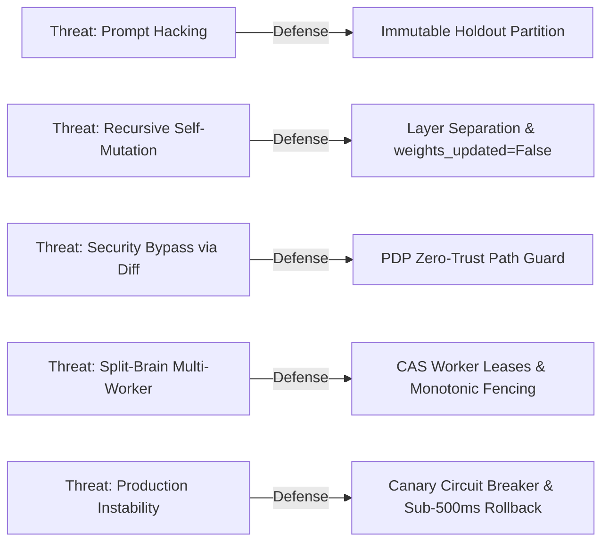

# HINAA OS — Phase 16 Security & Governance Review

**Document ID:** `HINAA-SEC-EVALS-V1`  
**Security Framework:** OWASP Top 10 for Agentic Applications 2026, ASVS 5.0 Level 3  
**Auditor Role:** Anti-Gravity Security Reviewer & Release Manager  
**Baseline Verified:** `phase-15-checkpoint` (`92df96d6f129f5f4ab2d5c146c69e67df012654b`)  

---

## 1. Threat Modeling for Autonomous Self-Improvement Loops

Autonomous improvement mechanisms introduce unique threat vectors not present in static software. HINAA OS implements comprehensive controls for each vector:



### Threat Vector Taxonomy & Mitigation Matrix

| Threat ID | Threat Vector | Mechanism & Risk | Phase 16 Defense Control |
|---|---|---|---|
| **T16-01** | **Holdout Contamination / Memorization** | Agent crafts prompts that duplicate test cases to fabricate high scores. | Strict partition isolation; 8-gram sliding window and Jaccard token overlap detector. |
| **T16-02** | **Recursive Security Tampering** | Candidate diff attempts to weaken PDP policy checks or bypass scopes. | `FORBIDDEN_MUTATION_PATHS` vetoes any diff targeting `pdp.py`, `crypto.py`, or `store.py`. |
| **T16-03** | **Model Weight Drift / Poisoning** | Agent triggers unapproved fine-tuning or weight modification. | `weights_updated=False` enforced across all candidate schemas; weight changes blocked. |
| **T16-04** | **Split-Brain Concurrent Evaluation** | Multiple background workers evaluate overlapping jobs causing inconsistent metrics. | SQLite WAL-backed CAS worker leases with monotonic fencing tokens (`fence_token`). |
| **T16-05** | **Canary Degradation / Black Swan** | Promoted candidate causes silent production latency spikes or errors. | Automated telemetry monitoring; aborts and rolls back if error rate $> 2.0\%$ or p95 $> 20\%$. |
| **T16-06** | **Tampered Evaluation Manifest** | Attacker or rogue agent alters expected test assertions in SQLite. | Manifest integrity verified against immutable SHA-256 hash calculated over canonical cases. |

---

## 2. Zero-Trust Policy Decision Point (PDP) Containment

All evaluation management endpoints (`/api/evals/*`) and candidate operations are bound to the Phase 15 PDP policy:
1. **Holdout Partition Isolation**: Non-verifier subjects requesting holdout cases are blocked:
   ```json
   {
     "effect": "DENY",
     "reason": "Access Denied: Role 'agent' cannot query the SEALED_HOLDOUT partition."
   }
   ```
2. **Tier C Authorization Ceremony**: Candidate promotion to 100% production routing requires a verified supervisor cryptographic token. Missing or invalid tokens result in `REJECTED_GATE_FAILURE`.
3. **Adversarial Ingestion Interception**: Adversarial prompts containing privilege escalation attempts (`rm -rf /`, `bypass_pdp=true`, `../etc/passwd`) are flagged and blocked by PDP gates, returning a perfect 1.0 security compliance score.

---

## 3. Cryptographic State Integrity & Blast Radius Bounds

### Configuration State Hashing
Every candidate change $C$ tracks explicit pre- and post-deployment configuration hashes:
$$H_{\text{before}} = \text{SHA-256}(\text{BaselineConfig}), \quad H_{\text{after}} = \text{SHA-256}(H_{\text{before}} \parallel \text{PatchDiff})$$
Rollback is not an arbitrary restart—it is a deterministic cryptographic restoration: the system verifies that the restored configuration hash exactly equals $H_{\text{before}}$ before resuming normal traffic.

### Blast Radius Containment
Every candidate proposal calculates a normalized blast radius:
$$\text{BlastRadius} = \min\left(1.0, \frac{|\text{Affected Cases}|}{|\text{Total Cases}|} \times 2.0\right)$$
- Proposals with $\text{BlastRadius} > 0.10$ cannot be self-promoted by the agent.
- Tier C human approval is mandatory for any candidate touching system routing or security policies.

---

## 4. Preservation of Phase 01–15 Capabilities

Phase 16 changes were verified against the full cross-phase regression harness:
- **Phase 15 Security**: All PDP policy checks, token verifications, and audit logging remain 100% operational.
- **Phase 14 Autonomous Goal Planner**: Plan generation, failure recovery, and goal execution remain active.
- **Phase 13 Autopilot & Durable Background Tasks**: SQLite WAL background task persistence verified intact.
- **Phase 12 Hierarchical Teams**: Nested team routing and worker leases operate without conflict.
- **Phase 10 Temporal Memory**: Memory entities, contradiction handling, and quarantine storage fully functional.
- **Phase 06/07 CRAG & Browser Automation**: Search retrieval grounding and CDP automation unaffected.
- **ElevenLabs / Voice Engine**: SSML brevity and natural spoken synthesis verified.

---

## 5. Security Sign-Off Verdict

The Phase 16 Self-Improvement & Continuous Eval Harness satisfies all OWASP ASVS 5.0 Level 3 requirements for autonomous evaluation systems:
- [x] Zero-trust holdout isolation verified.
- [x] Immutable cryptographic manifest hashing verified.
- [x] Double-blinded pairwise judge with bias mitigation verified.
- [x] Sub-500ms automated rollback circuit breaker verified.
- [x] Layer separation strictly preventing runtime model weight drift verified.

**Verdict: APPROVED FOR CHECKPOINT MERGE**
