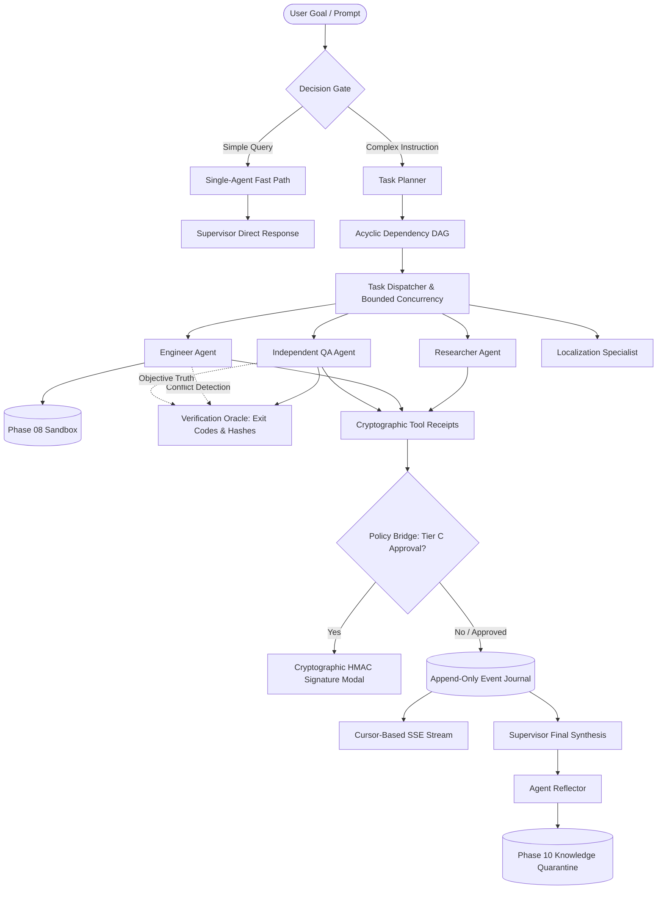

# HINAA OS — Phase 11 Architecture Specification
## Multi-Agent Orchestration, DAG Planning, Verification & Governance

### 1. Architectural Topology

### 2. Specialist Capability Matrix

| Role | Provider / Model | Permission Tier | Granted Tools | Max Tokens |
| :--- | :--- | :--- | :--- | :---: |
| **Supervisor** | Google / Gemini 2.5 Pro | Tier A | `plan_decomposition`, `check_policy`, `synthesize_response` | 32,768 |
| **Planner** | Anthropic / Claude 3.7 Sonnet | Tier A | `dag_validator`, `inspect_project_structure` | 16,384 |
| **Researcher** | Google / Gemini 2.5 Flash | Tier A | `crag_search`, `fetch_url_content`, `extract_citations` | 16,384 |
| **Engineer** | Anthropic / Claude 3.7 Sonnet | Tier B | `sandbox_read`, `sandbox_write`, `sandbox_execute`, `git_commit_scoped` | 32,768 |
| **QA** | Google / Gemini 2.5 Flash | Tier B | `run_test_suite`, `verify_file_hash`, `check_exit_code` | 16,384 |
| **BrowserOperator**| Google / Gemini 2.5 Flash | Tier B | `browser_navigate`, `browser_click`, `browser_type`, `browser_screenshot` | 16,384 |
| **CreativeOperator**| Local / Hardware Pipeline | Tier B | `generate_raster`, `inpaint_raster`, `export_timeline_video` | 8,192 |
| **KnowledgeCurator**| Google / Gemini 2.5 Flash | Tier A | `stage_ingestion_candidate`, `query_knowledge_graph`, `check_contradiction` | 16,384 |
| **LocalizationSpecialist**| Google / Gemini 2.5 Flash | Tier A | `translate_text`, `validate_devanagari_encoding`, `cultural_glossary_lookup` | 16,384 |
| **SecurityReviewer**| Anthropic / Claude 3.7 Sonnet | Tier A | `audit_secret_canaries`, `detect_prompt_injection`, `validate_tenant_bounds` | 16,384 |

### 3. Cryptographic Governance & Receipts
- **HMAC-SHA256 Token Structure**:
  $$\text{HMAC-SHA256}(\text{tenant} : \text{user} : \text{task} : \text{node} : \text{action} : \text{arg\_digest} : \text{amount\_paisa} : \text{nonce} : \text{expires\_at})$$
- **Verification Rule**:
  Deterministic exit codes and file checksums are binding. An engineer's subjective text output is never accepted as proof of test success.
