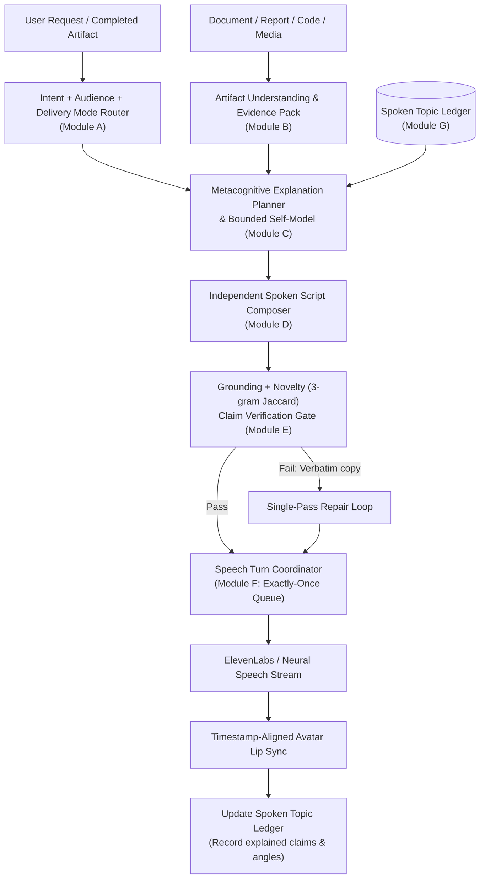

# HINAA OS — Reflective Voice & Metacognitive Explanation Engine
## Architecture Specification & Engineering Reference
**Status:** Implemented & Verified  
**Milestone:** Post-Phase-13 Quality Enhancement Layer  
**Subsystem:** `hinaa_api.explanation` & `apps/web/src/features/audio`

---

## 1. Executive Summary & Problem Diagnosis

### The Core Problem
Previously, when Hina generated long artifacts (such as 10-page research reports, multi-file code diffs, markdown tables, or structured summaries), the voice system suffered from two major failure modes:
1. **Reciting Artifacts Verbatim (Intent Mismatch — Cause B):** Rather than providing a natural spoken briefing or conversational explanation, the streaming speech pipeline fed raw markdown text deltas (`### Heading`, `| Table |`, `[1]`, code blocks) directly into the speech synthesis queue. Hina was forced to read whole documents mechanically word for word.
2. **Audio Duplication & Concurrency Races (Cause A):** Without monotonic generation IDs and deterministic segment idempotency keys, reconnected SSE streams, duplicate TTS callbacks, and trailing non-streaming completion flushes could enqueue identical audio segments twice, causing overlapping or repeated speech.
3. **Dialogue Looping (Cause C):** Because the system lacked a short-lived conversational topic ledger, follow-up turns ("tell me more", "explain it differently") repeatedly explained the same introductory paragraphs.
4. **Verbatim Ambiguity (Cause D):** The system lacked explicit intent routing to disambiguate deliberate requests to "read word for word" (`READ_VERBATIM`) from conversational requests to "explain the report" (`EXPLAIN_BRIEFLY` / `EXPLAIN_FULLY`).

---

## 2. Architectural Contract

---

## 3. Subsystem Breakdown

### Module A: Delivery Intent & Mode Router (`router.py`)
Disambiguates conversational requests across English, Devanagari Nepali, Romanized Nepali, and code-mixed inputs:
- `EXPLAIN_BRIEFLY`: ~20–45s briefing highlighting 2–4 critical takeaways.
- `EXPLAIN_FULLY`: Systematic walkthrough section by section with user pauses.
- `EXPLAIN_DIFFERENTLY`: Fresh analogy, metaphor, or framework preserving all source facts.
- `PERSPECTIVE_AND_CRITIQUE`: Highlights tradeoffs, risks, and counterarguments; explicitly separates fact from interpretation.
- `TEACH_STEP_BY_STEP`: Pedagogical guide adapted to user pace (e.g. "I don't understand section 2").
- `DISCUSS`: Interactive two-way discussion with follow-up options.
- `READ_VERBATIM`: Exact word-for-word document reading without paraphrase, only when deliberately requested.
- `VOICE_CHAT`: Normal interactive conversational dialogue.

### Module B: Artifact Understanding & Evidence Pack (`analyzer.py`)
Extracts structured intelligence from documents, code patches, and media:
- Computes SHA-256 hash to detect changes and invalidate caches.
- Parses headings, section summaries, main objectives, and conclusions.
- Extracts `KeyClaim` records with exact source spans (`char_offset` / `line_range`), confidence ratings, and citation IDs (`[1]`, `[Doc-3]`).
- For code artifacts: anchors to **real execution receipts** (actual diff line counts, test suite passed/failed counts, durations) rather than inferred success.
- Enforces tenant isolation across all cached representations.

### Module C: Metacognitive Explanation Planner (`planner.py`)
Constructs an `ExplanationPlan` before speech generation:
- **Bounded Self-Model:** Explicitly defines observable capabilities and hard limitations. **Strict zero-consciousness boundary:** never claims subjective sentience, feelings, consciousness, or human brain states.
- Prioritizes user goals, surprising tradeoffs, and risks rather than mechanically taking the first paragraph.
- Consults `SpokenTopicLedger` to avoid reusing previously spoken claim IDs and narrative angles.

### Module D: Spoken Script Composer (`composer.py`)
Composes fresh conversational speech grounded in verified evidence:
- Strips visual syntax: markdown tables, URLs, raw code blocks, and bracketed citation numbers (`[1]`, `[2]`).
- Formulates spoken transitions in English, Nepali (Devanagari), and mixed code-switching.
- In `READ_VERBATIM`: preserves exact text without paraphrase.

### Module E: Grounding, Novelty & Verification Gate (`verifier.py`)
- Evaluates 3-gram Jaccard similarity against the raw artifact:
  $$\text{Jaccard}(A, B) = \frac{|G_3(A) \cap G_3(B)|}{|G_3(A) \cup G_3(B)|}$$
- For non-verbatim modes, if 3-gram Jaccard $> 0.65$, flags unwanted mechanical copying and triggers single-pass repair.
- Tags every sentence with `ClaimPerspective`: `SOURCE_SUPPORTED`, `INFERENCE`, `INTERPRETATION`, or `NOT_ENOUGH_EVIDENCE`.
- Defends against embedded prompt injections (e.g. malicious documents instructing the model to announce payments or bypass guards).

### Module F: Speech Turn Coordinator (`coordinator.py`)
- Monotonically increasing `generation_id` per turn.
- Deterministic idempotency key per segment:
  $$\text{Key} = \text{SHA-256}(\text{conversation\_id} : \text{response\_id} : \text{generation\_id} : \text{segment\_index} : \text{clean\_text})$$
- Out-of-order chunk reassembly buffer: guarantees segments are delivered strictly in index sequence $(0, 1, 2, \dots)$.
- Barge-in engine: instantaneously advances generation, cancels in-flight synthesis, drains local audio buffers, and ignores stale callbacks.

### Module G: Conversational Topic Ledger (`ledger.py`)
- Persistent SQLite table (`spoken_topic_ledger`) with memory cache.
- Tracks `claim_ids_explained`, `narrative_angle`, `examples_used`, and `last_speech_turn`.
- Invalidation hook: deleting an artifact purges all derived ledger records.

### Module H: UI Experience (`ArtifactCardV6.tsx` & `App.tsx`)
- Adds 5 dedicated action buttons to artifact cards:
  - `[Brief Explanation]`
  - `[Detailed Walkthrough]`
  - `[Another Perspective]`
  - `[Read Verbatim]`
  - `[Discuss with Hina]`
- Separate visual display (full document on screen) from spoken script (concise, conversational audio).
