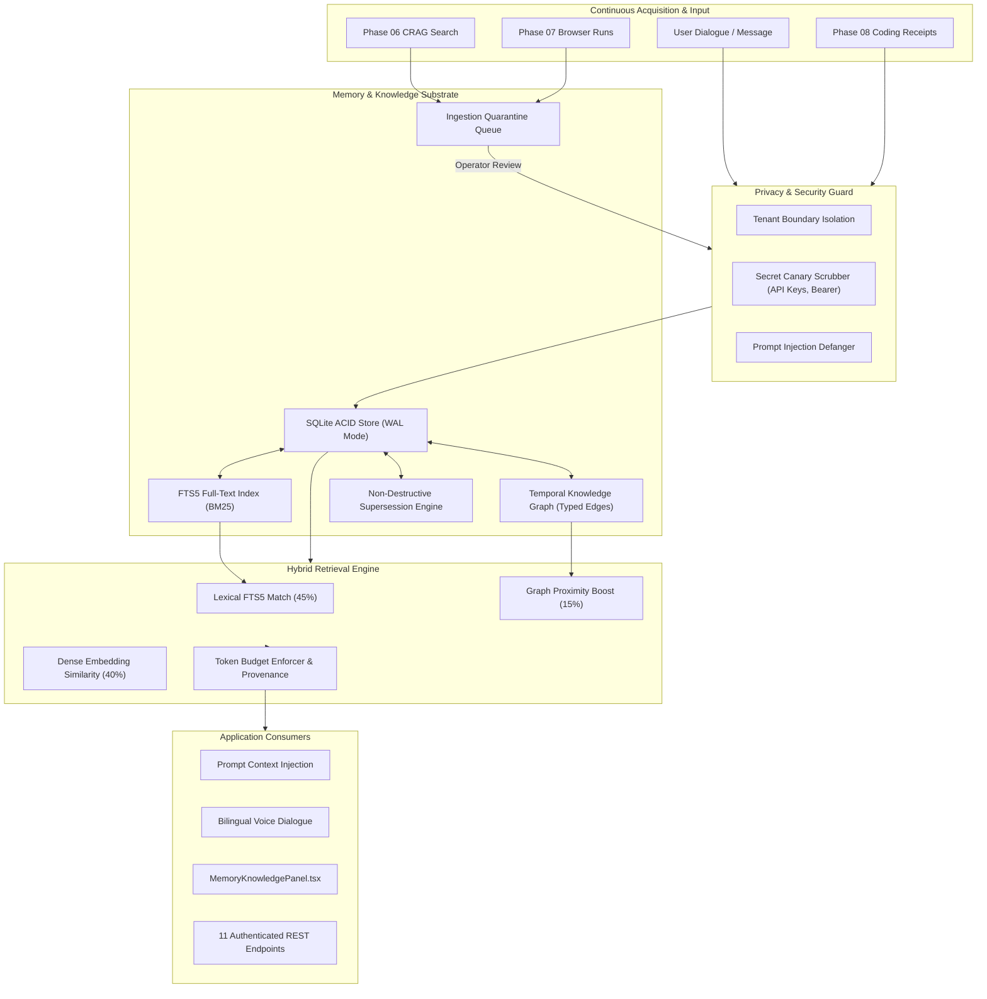

# HINAA OS — Phase 10: Long-Term Memory & Continuous Knowledge Graph Architecture

## 1. Architectural Overview

The Phase 10 Memory System transforms HINAA OS from a session-buffered conversational assistant into a persistent, stateful cognitive entity with long-term biographical, project, and environmental knowledge.

---

## 2. Component Specifications

### 2.1 Persistence Layer (`apps/api/hinaa_api/memory/repository.py`)
- **Engine**: SQLite with Write-Ahead Logging (`PRAGMA journal_mode=WAL`), foreign keys (`PRAGMA foreign_keys=ON`), and `PRAGMA synchronous=NORMAL`.
- **Location**: `apps/api/data/hinaa_memory.db`.
- **Indexing**: `memory_fts` SQLite FTS5 table with triggers automatically synchronizing inserts, updates, and deletes with Unicode61 tokenization supporting English and Devanagari script.
- **Transactions**: Thread-safe with reentrant locking (`threading.RLock`) and immediate transactions for data integrity.

### 2.2 Temporal Knowledge Graph (`apps/api/hinaa_api/memory/graph.py`)
- **Nodes**: Unique entities with canonical names, typed tags (`Person`, `Project`, `Technology`, `Location`, `Concept`), and bilingual aliases (e.g. `Kathmandu`, `काठमाडौं`, `KTM`).
- **Edges**: Directed relationships (`PREFERS`, `WORKS_ON`, `LOCATED_IN`, `SUPERSEDES`, `CONTRADICTS`) with confidence scores and point-in-time validity (`valid_from` to `valid_to`).
- **Safety Bounds**: Traversal explicitly capped at `max_depth <= 3` and `max_nodes <= 50` with visited set tracking to prevent runaway circular graphs.

### 2.3 Hybrid Retrieval Engine (`apps/api/hinaa_api/memory/retrieval.py`)
- **Weighted Blending**:
  $$\text{Score} = (0.45 \times \text{Lexical}_{\text{BM25}}) + (0.40 \times \text{Semantic}_{\text{Cosine}}) + (0.15 \times \text{Graph}_{\text{Neighbor}})$$
- **Token Budgeting**: Bounded extraction preventing context window saturation (default 2048 tokens, configurable down to 64 tokens).
- **Provenance**: Every retrieved memory includes source URL, tool origin, timestamp, trust tier, and evidence quote.

### 2.4 Non-Destructive Contradiction Resolution (`apps/api/hinaa_api/memory/contradictions.py`)
- Detects polarity flips (`love` vs `hate`, `prefer` vs `avoid`) and explicit update phrasing (`moved to`, `switched to`).
- Previous assertion marked `is_contradicted=True`, `superseded_by_id=new_id`.
- Knowledge graph connects entities with a `SUPERSEDES` edge and records audit reason.
- Active queries exclude superseded memories by default; historical auditing retrieves full evolution lineage.

### 2.5 Continuous Acquisition Quarantine (`apps/api/hinaa_api/memory/ingestion.py`)
- Staging queue for candidate facts discovered by automated agents.
- Facts remain isolated in `pending` status until human operator or verifier agent signs off.
- Prevents untrusted external web content or model hallucinations from polluting long-term core memory.
