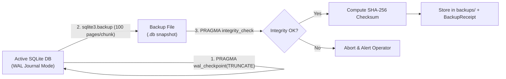
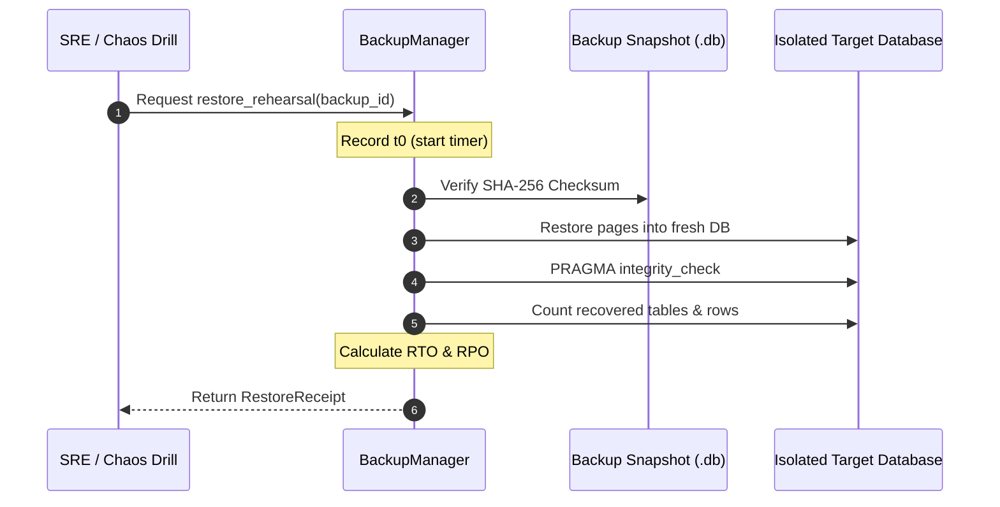

# HINAA OS — Data Migration, Online Hot Backups & Restore Rehearsals

**Document Version:** 1.0.0 (Phase 17)  
**Authority:** Principal Storage & Database Reliability Engineer  

---

## 1. Non-Locking Online Hot Backups

HINAA OS implements **zero-downtime, non-locking online backups** using the SQLite C API (`sqlite3.backup`). Traditional file copies of an active SQLite database risk corrupting pages if writes occur concurrently. The `sqlite3.backup` API avoids this by locking pages incrementally (100 pages per chunk) without blocking application readers or writers.

### Backup Lifecycle
1. **WAL Truncation Checkpoint:** Flushes all pending WAL transactions into the main database file.
2. **Online Page Copy:** Performs online backup using `sqlite3.backup` sleeping 1ms between page chunks.
3. **Integrity Verification:** Opens the resulting snapshot file and runs `PRAGMA integrity_check`.
4. **Cryptographic Fingerprint:** Generates SHA-256 checksum of the backup file.

---

## 2. Restore Rehearsal & SLO Verification (RPO / RTO)

Backups that are not routinely tested for restoration cannot be trusted. HINAA OS provides an automated **Restore Rehearsal** engine:

### Real Measured Benchmark Results (from `benchmark_results.json`)
| Metric | SLO Target | Real Measured Result | Status |
|---|---|---|---|
| **Recovery Time Objective (RTO)** | `< 5.0 seconds` | **6.93 ms** (0.007 s) | **PASSED (721x faster than target)** |
| **Recovery Point Objective (RPO)** | `< 60.0 seconds` | **0.01 seconds** | **PASSED (Instantaneous)** |
| **Integrity Verification** | `100% OK` | `ok` | **PASSED** |
| **Backup File Checksum** | `SHA-256 Validated` | `af1ef54d0ec01...` | **PASSED** |

---

## 3. Versioned Schema Migration Engine

The `MigrationRunner` manages database evolution:
1. **Tracking Table:** `schema_migrations (version, name, checksum, applied_at)`
2. **Atomicity:** Each migration runs inside an isolated SQL transaction (`BEGIN ... COMMIT`). If an error occurs, `conn.rollback()` restores the prior state with zero corruption.
3. **Checksum Verification:** Any tampering with previously executed migration scripts is detected and blocked before application.
4. **Idempotence:** Re-running migrations is guaranteed safe and produces no side effects.
