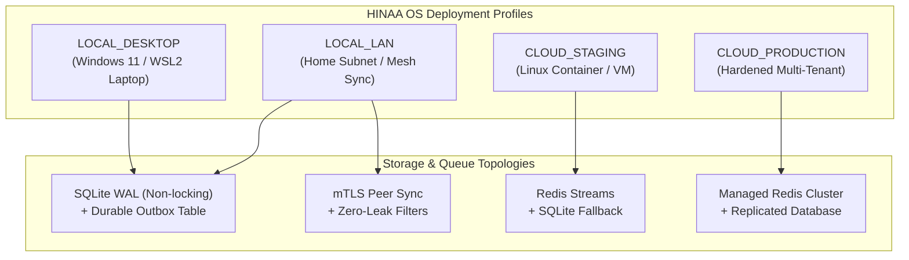

# HINAA OS — Deployment Profiles & Honest Topology Specification

**Document Version:** 1.0.0 (Phase 17)  
**Authority:** Principal Platform & Reliability Engineer  

---

## 1. Overview & Honest Capability Classification

A critical non-negotiable principle in HINAA OS is **honest capability reporting**:
> **Never describe a single Windows 11 laptop, single host Docker Compose, or local process group as cross-host High Availability or multi-master cloud consensus.**

Capabilities must be classified under one of the canonical verification statuses:
- `LOCAL_VERIFIED`: Directly executed and verified on the local host (e.g. SQLite WAL, offline queues).
- `MULTI_PROCESS_SAME_HOST_VERIFIED`: Verified across distinct host processes (e.g. API + Worker + Client on same machine).
- `MULTI_HOST_VERIFIED`: Multi-machine cluster verified across independent physical or cloud nodes.
- `CONFIG_REQUIRED`: Architecture supported by code but requires external cloud infrastructure (e.g. managed Redis, PostgreSQL cluster).
- `CONTAINER_BUILD_BLOCKED`: Container build or runtime blocked by host engine availability (e.g. Docker Desktop Linux engine offline).
- `NOT_TESTED`: Untested configuration topology.

---

## 2. Deployment Profiles Matrix

### Profile 1: `LOCAL_DESKTOP` (Default Personal AI)
- **Target Host:** Single Windows 11 / macOS / Linux developer laptop.
- **Queue Backend:** `SQLITE_DURABLE` (Transactional Outbox table in SQLite WAL).
- **Network Dependency:** **Zero.** 100% offline-first. Probes report `HEALTHY` with no internet access.
- **GPU Utilization:** Direct host CUDA (e.g. NVIDIA GeForce RTX 4060 Laptop GPU, 8188 MiB VRAM).
- **Security:** Strict loopback binding (`127.0.0.1`), debug mode permitted for development.
- **Verification Status:** `LOCAL_VERIFIED`.

### Profile 2: `LOCAL_LAN` (Home Subnet Collaboration)
- **Target Host:** Primary workstation broadcasting to paired mobile devices over Wi-Fi / LAN.
- **Queue Backend:** `SQLITE_DURABLE` with peer edge synchronization.
- **Replication Engine:** Authenticated device pairing with SHA-256 public key fingerprints.
- **Zero-Leak Filtering:** Secrets, passwords, bearer tokens, and audio recordings are stripped before sync.
- **Verification Status:** `MULTI_PROCESS_SAME_HOST_VERIFIED`.

### Profile 3: `CLOUD_STAGING` (Single/Multi Container Linux Staging)
- **Target Host:** Linux container / VM running Docker Compose.
- **Queue Backend:** Redis Streams (`redis://...`) with automatic fallback to SQLite durable queue.
- **Security Constraints:** Debug mode disabled, wildcard CORS prohibited, secrets checked for length (>32 chars).
- **Verification Status:** `CONFIG_REQUIRED` when running on laptop without external Redis cluster.

### Profile 4: `CLOUD_PRODUCTION` (Hardened Multi-Tenant Cluster)
- **Target Host:** Kubernetes / Managed Cloud Cluster with TLS Termination (Caddy / Nginx).
- **Security Constraints:**
  - Non-root user: `USER hinaa` (UID 10001, GID 10001).
  - Multi-stage distroless/slim runtime image.
  - Strict CSP, HSTS, X-Frame-Options headers.
  - Resource caps (CPU & Memory limits).
  - Automated healthcheck probes (`/health/live`, `/health/ready`).
- **Verification Status:** `CONFIG_REQUIRED` without cross-host orchestration.

---

## 3. Environment Schema Validation Rules

The `EnvironmentConfig` schema enforces:
1. **Debug Mode:** `debug: False` strictly required in `CLOUD_STAGING` and `CLOUD_PRODUCTION`.
2. **CORS Origins:** Wildcard (`*`) is rejected in production profiles.
3. **Secret Key:** Minimum 32 characters, rejecting trivial passwords (`admin`, `123456`, `secret`).
4. **TLS:** Enforced on production profiles.
