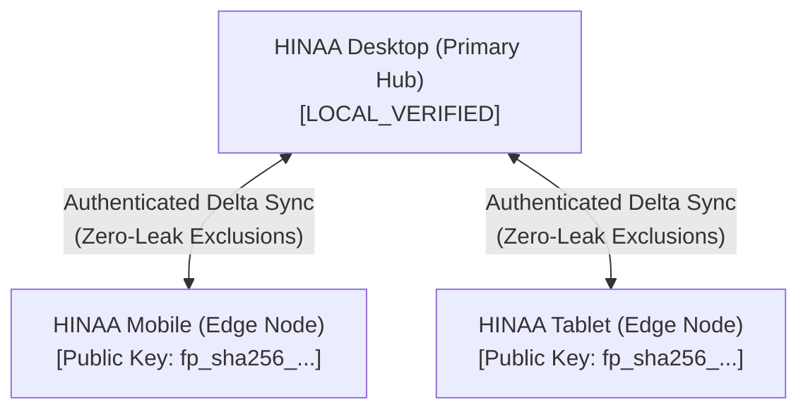
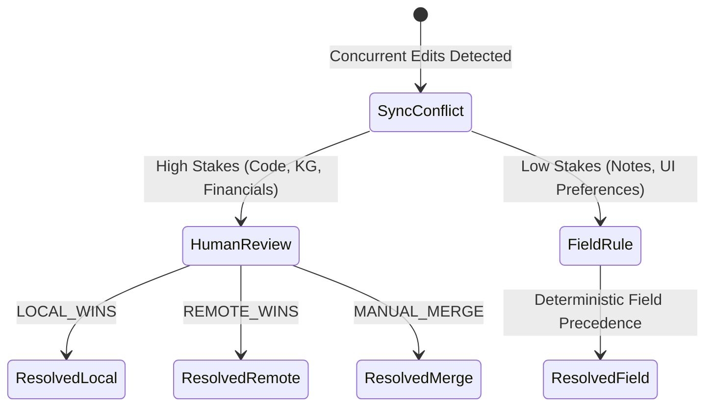

# HINAA OS — Edge Synchronization, Zero-Leak Privacy & Conflict Resolution

**Document Version:** 1.0.0 (Phase 17)  
**Authority:** Principal Privacy & Edge Architect  

---

## 1. Overview: Local-First Mesh Topology

HINAA OS operates as a **local-first personal AI system**. While cloud profiles exist for staging and multi-tenant hosting, personal user devices (laptops, phones, tablets) coordinate through an authenticated, zero-leak edge synchronization mesh.

---

## 2. Zero-Leak Privacy & Replication Invariants

To guarantee that private user data and sensitive security tokens never escape the primary host device, `EdgeSyncEngine` enforces the **Zero-Leak Rules**:

### Excluded Field Sanitization
Any record buffered for replication is automatically stripped of fields matching sensitive patterns:
- `secret`
- `password`
- `token`
- `private_key`
- `cookie`
- `approval_token`
- `biometric`

### Prohibited Record Types
Certain categories of records are strictly barred from syncing over the mesh:
- `secrets`: Local encryption keys and master secrets.
- `payment_approval`: Elevated Tier C financial approval signatures.
- `auth_session`: Browser and session cookies.
- `raw_voice_recording`: High-bandwidth local raw PCM audio streams.

Attempts to buffer prohibited record types immediately raise a `PermissionError` and trigger security alerts.

---

## 3. Cryptographic Device Pairing & Instant Revocation

1. **Pairing Handshake:** Devices exchange public key fingerprints (`public_key_fingerprint`).
2. **Tenant Scoping:** Each paired device is assigned an `allowed_tenants` whitelist (`["default", ...]`).
3. **Instant Revocation Kill-Switch:**
   - Calling `/api/platform/sync/revoke?device_id=...` immediately sets device status to `REVOKED`.
   - Any future sync attempt from that device is rejected with a `403 Forbidden` / `PermissionError`.

---

## 4. Delete Tombstones & Conflict Resolution

### Tombstone Deletion
When a user deletes an entity, it is not immediately pruned from disk. A `DELETE_TOMBSTONE` event with an incremented version number is replicated across paired nodes to ensure deletions propagate correctly without being resurrected by out-of-order delta syncs.

### Conflict Resolution Strategies
1. **`DETERMINISTIC_FIELD_RULE` (Low Stakes):** Automated deterministic resolution for non-critical UI settings and note metadata.
2. **`STRUCTURED_HUMAN_REVIEW` (High Stakes):** Preserves both payloads in `platform_sync_conflicts` for explicit operator review in the `ProductionControlPanel` UI.
3. **`TOMBSTONE_PRECEDENCE`:** Deletions take precedence over concurrent updates.
