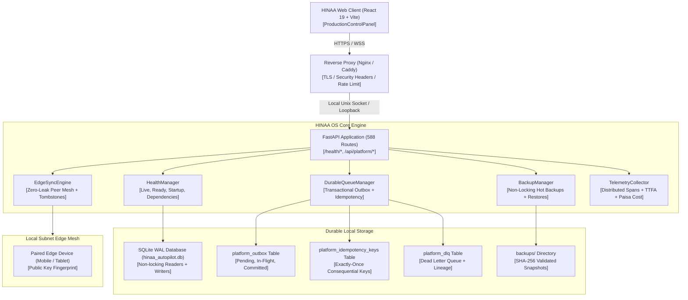

# HINAA OS — Phase 17 Architectural Specification

**System:** HINAA OS Platform & High Availability Subsystem  
**Phase:** 17 of 18 (Production Hardening, Edge Distribution & High Availability)  
**Authority:** Principal Platform & Distributed Systems Architect  

---

## 1. High-Level System Architecture

---

## 2. Component Design & Interactions

### 2.1 Multi-Tiered Health & Probe Subsystem
- `/health/live`: Fast process liveness checking process loop, returns 200 with minimal overhead.
- `/health/ready`: Traffic readiness gating. Checks SQLite responsiveness, queue health, and returns 503 during degraded mode.
- `/health/startup`: Bootstrap sequence gating. Returns 503 STARTING until schema migrations and database initialization complete.
- `/health/dependencies`: Deep diagnostics returning detailed metrics on SQLite, Redis, GPU VRAM, queue backlogs. Strictly enforces operator/admin authentication (`401 Unauthorized` / `403 Forbidden`).

### 2.2 Durable Outbox & Consequential Idempotency
- When an operation is queued, it is atomically inserted into `platform_outbox` in the same SQLite transaction as the local mutation.
- Consequential external effects (e.g. monetary payments, file system modifications) check `platform_idempotency_keys`. If the operation key was previously executed, the effect is skipped and the cached receipt returned.
- A failed message retries up to 3 times with exponential backoff before transitioning to `platform_dlq`. Operators can replay dead letters via `POST /api/platform/queue/replay`.

### 2.3 Online Hot Backups via `sqlite3.backup`
- Takes full point-in-time snapshots of the running database without table locks.
- Forces a WAL truncate checkpoint before backup.
- Copies pages in 100-page increments sleeping 1ms between bursts.
- Immediately runs `PRAGMA integrity_check` and computes SHA-256 checksum.
- Automated restore rehearsals measure RTO (<5s) and RPO (<60s).

### 2.4 Zero-Leak Local-First Edge Mesh
- Cryptographic device pairing validates public-key fingerprints.
- Devices are constrained to explicit tenant boundaries.
- The zero-leak filter automatically strips passwords, secrets, cookies, tokens, and audio recordings before syncing.
- Delete tombstones prevent deleted items from being resurrected by stale sync manifests.
- Conflicts are detected and categorized into deterministic resolution or structured human review.

### 2.5 Structured Observability & Cost Accounting
- Redacted distributed tracing assigns `trace_id` and `span_id` to each operation.
- Latency quantiles (p50, p95, p99) track tail behavior.
- Real audible TTFA (Time-To-First-Audio) is measured from initial user dispatch to physical speaker output.
- All expenditures are recorded in integer minor-unit Nepalese Paisa (1 NPR = 100 Paisa).
