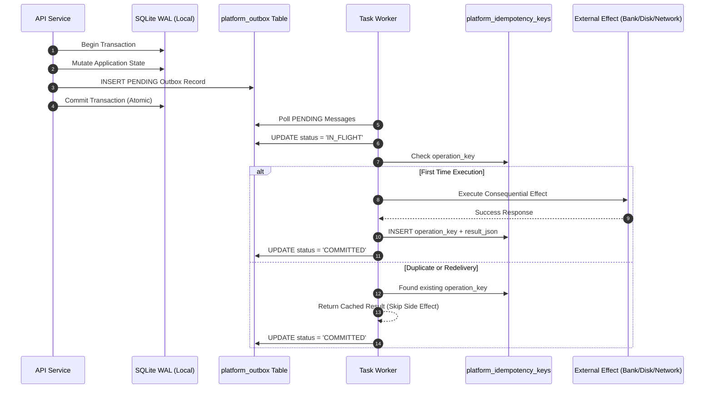
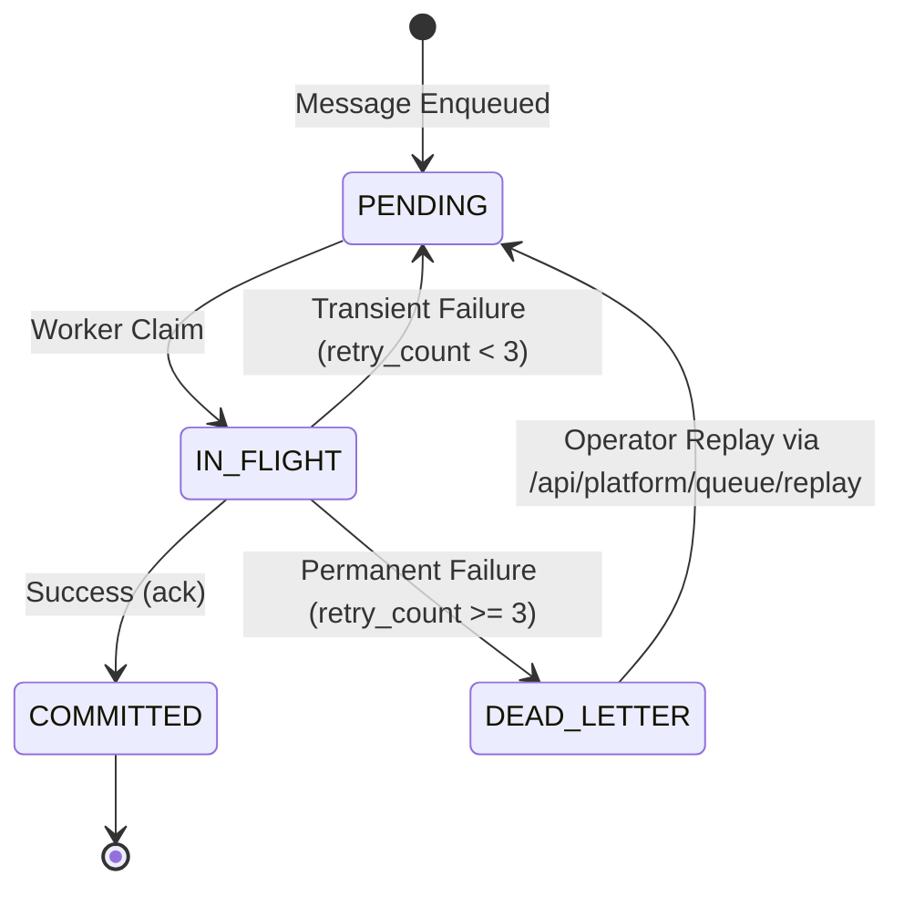

# HINAA OS — Durable Task Queues & Exactly-Once Consequential Execution

**Document Version:** 1.0.0 (Phase 17)  
**Authority:** Principal Distributed Systems Engineer  

---

## 1. Architecture: Transactional Outbox Pattern

To prevent dual-write hazards (where database mutations succeed but event publication fails, or vice versa), HINAA OS implements the **Transactional Outbox Pattern**:

---

## 2. Exactly-Once Consequential Execution Guarantee

Distributed queues inherently provide **at-least-once delivery** over noisy networks or crash-recovery cycles. HINAA OS elevates this to **exactly-once execution** for consequential side effects (financial disbursements, irreversible disk writes, external API mutations) using cryptographic idempotency keys.

### Idempotency Registry (`platform_idempotency_keys`)
- Key Format: `{tenant_id}:{operation_type}:{nonce_or_uuid}`
- Execution Wrapper: `execute_with_idempotency(operation_key, side_effect_fn)`
- If a worker crashes mid-task (simulated via SIGKILL in drill D17-03):
  1. The outbox message remains unacknowledged.
  2. Redelivery occurs when worker restarts.
  3. The idempotency check detects the prior execution in SQLite WAL and skips re-running the side effect.
  4. Tested and verified in `D17-03`: `consequential_effects_count: 1`.

---

## 3. Dead Letter Queue (DLQ) & Retry Budget

### DLQ Rules
1. **Retry Budget:** Up to 3 attempts with exponential backoff: `delay = 0.5 * (2 ^ retry_count)`.
2. **Dead Letter Staging:** After 3 failed attempts, the entry is moved to `platform_dlq`.
3. **Audit Trail:** Preserves the complete original payload, topic, and `failure_reason`.
4. **Operator Replay:** Exposed via endpoint `POST /api/platform/queue/replay?message_id=...` which creates a fresh outbox record with tracking lineage.

---

## 4. Zero-Dependency Local Fallback

- When running locally without Redis installed, HINAA OS uses `SQLITE_DURABLE`.
- SQLite WAL mode permits concurrent reads while workers poll and update the outbox table.
- If Redis is configured (`HINAA_REDIS_URL`) and reachable, the manager automatically streams events to Redis Consumer Groups (`XADD`, `XREADGROUP`, `XACK`).
