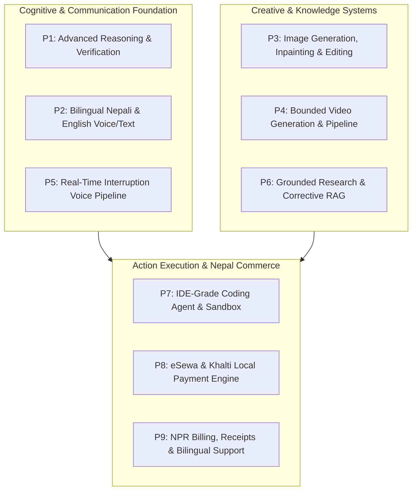

# HINAA OS — Product Requirements Specification V3 (Master Addendum)

**Version**: 3.0.0  
**Date**: November 2026  
**Status**: Authoritative Product Specification & Engineering Roadmap  
**Scope**: Full Bilingual (Nepali & English) Nepal-Ready Advanced AI Platform  

---

## 1. Vision & Architectural Position

HINAA is an autonomous, bilingual AI platform and independent companion tailored for Nepal and the global community. She combines persistent identity, emotional agency, visual perception, low-latency conversational voice, grounded verifiable research, an IDE-grade autonomous coding agent, creative studios (image/video), and secure local Nepal monetization via eSewa and Khalti.

HINAA operates on **bounded initiative and technical accountability**:
- She possesses proactive reasoning, task planning, and emotional adaptability without false claims of biological consciousness or ungrounded cognition.
- Financial transactions, destructive file mutations, production deployments, and external communications are strictly quarantined under **Tier C Human Cryptographic Authorization**. HINAA does not spend user funds autonomously.

---

## 2. The Nine Core Product Capabilities

### P1. Advanced Reasoning & Decision-Making
- **Decomposition & Planning**: Multi-step goal decomposition with budget trees and formal pre/postcondition verifications.
- **Adaptive Model Selection**: Routing across `ULTRA_FAST`, `BALANCED`, `REASONING_CODE`, and local Neural Lab fine-tunes based on algorithmic turn complexity scoring.
- **Uncertainty & Abstention**: Explicit detection of factual ambiguity, knowledge boundaries, and contradiction disclosure.

### P2. Bilingual Nepali and English Conversations
- **Native Scripts**: Full support for English, नेपाली (Devanagari Unicode), Romanized Nepali, and natural code-switching (*Nepali-English hybrid phrasing*).
- **Indic-Safe Tokenization**: Preservation of Devanagari vowel signs (*matras*) and conjuncts without destructive transliteration.
- **Cultural Disambiguation**: Deep domain knowledge of Nepali terms, festivals, geographic locations, and local tech ecosystems.

### P3. Image Generation & Editing
- **Capabilities**: Text-to-image, image-to-image, mask-based inpainting, background removal, and aspect ratio controls.
- **Provenance**: Full provenance tracking (seed, prompt, model version, parent asset ID) stored in asset inventory.
- **Safety**: Strict moderation and clear tagging distinguishing generated media from external factual evidence.

### P4. Video Generation & Queues
- **Pipelines**: Text-to-video and image-to-video via verified providers with job queuing and cancel/retry support.
- **Hardware & Cost Budgeting**: Detection of available local VRAM (RTX 4060 Laptop 8GB) vs. remote API with graceful degradation.
- **Output Management**: Bounded duration (2s to 10s), progress telemetry, and downloadable MP4 artifacts.

### P5. Real-Time Conversational Voice
- **Low-Latency Pipeline**: 9-state voice turn lifecycle with sub-400ms time-to-first-audio (TTFA).
- **True Barge-In**: Immediate streaming cancellation and audio queue purge upon user speech detection (`generation_id` validation).
- **Prosody Modulation**: 4D continuous emotional vector ($\text{valence}, \text{arousal}, \text{dominance}, \text{focus}$) modulating TTS pitch, rate, and warmth.

### P6. Research with Verified Sources
- **Corrective RAG (CRAG)**: Retrieval quality scoring, algorithmic query rewrites, and SimHash deduplication.
- **Claim-Level Grounding**: Fine-grained textual entailment auditing, automatic stripping of hallucinated citations (`[999]`), and contradiction surfacing.
- **Live Search**: Verified live web retrieval via Exa API / YDC with real timestamping and publisher trust tiers.

### P7. Complete AI Coding Agent (Phase 08)
- **IDE Workspace**: Repository explorer, symbol search, dependency inspection, and structured patch generator.
- **Execution Sandboxing**: Isolation backends (Docker, WSL2, or Restricted Windows Job Object) with memory/CPU limits and zero credential inheritance.
- **Deterministic Verification**: Automated linting, typechecking (`tsc -b`), unit tests (`pytest`), and build verification before sign-off.
- **Git & Safety**: Feature branching, non-destructive diffs, atomic rollback, and explicit user authorization for consequential actions.

### P8. Nepal Local Checkout — eSewa and Khalti
- **User-Authorized Monetization**: Strictly for customer purchases (credits, memberships, subscriptions); HINAA never spends funds autonomously.
- **eSewa Integration**: Signed checkout requests with HMAC-SHA256, merchant-controlled order IDs, callback handling, and server-to-server transaction verification.
- **Khalti Integration**: Merchant-side ePayment initiation (`/epayment/initiate/`), hosted payment URL, `pidx` tracking, integer minor units (paisa: 100 paisa = 1 NPR), and server-side `/epayment/lookup/`.
- **Order State Machine**: `CREATED`, `PENDING`, `PAID`, `FAILED`, `EXPIRED`, `CANCELLED`, `REFUNDED`.
- **Idempotency & Reconciliations**: Replay protection, atomic entitlement updates, and strict sandbox environment testing before merchant credential deployment.

### P9. NPR Pricing & Bilingual Customer Support
- **Currency Standards**: Canonical storage in minor units (paisa) with explicit display format: `रु 1,000.50` / `NPR 1,000.50` using South Asian comma grouping (`1,00,000`).
- **Bilingual Interface**: Language toggle between English and Nepali across plans, checkout modals, payment receipts, and error dialogs.
- **Customer Support**: Grounded support assistant handling billing inquiries, order status lookups, refund requests, and human escalation tickets without cross-tenant data leakage.

---

## 3. Product Decision: Personal Desktop vs. Public Cloud Deployment

HINAA OS is architected to operate in **Hybrid Deployment Mode**:
1. **Personal Desktop Mode (Default / Active)**:
   - Local FastAPI + Vite desktop server running on localhost (`0.0.0.0:8000` / `localhost:5173`).
   - Direct hardware utilization (NVIDIA RTX 4060 Laptop GPU, VMC avatar bridge, local audio microphones).
   - Local development sandbox and workspace tooling.
2. **Public SaaS / Multi-Tenant Mode (Commerce & Mobile Ready)**:
   - Centralized tenant isolation (`tenant_id` namespace across sessions, DB records, and sandbox contexts).
   - Clerk authentication integration (`apps/api/hinaa_api/clerk_auth.py`).
   - eSewa & Khalti webhook listeners with server-side secret management.
   - Entitlement gating (`Tier A/B/C` capabilities based on active user subscription).

---

## 4. Engineering Traceability to 18-Phase Evolution

The 9 capabilities map directly into HINAA's canonical 18-phase evolution ledger without renumbering:
- **Phase 01–03**: Foundation, Model Fabric, Deep Inference $\rightarrow$ **P1 (Advanced Reasoning)**
- **Phase 04**: Conversational Intelligence, Identity, Mood $\rightarrow$ **P1, P2 (Identity & Nepali Context)**
- **Phase 05**: Real-Time Voice Intelligence $\rightarrow$ **P2, P5 (Real-Time Voice)**
- **Phase 06**: Grounded Research & Corrective RAG $\rightarrow$ **P6 (Research with Sources)**
- **Phase 07**: Browser Automation & Web Operations $\rightarrow$ **P6, P7 (Browser QA & Web Actions)**
- **Phase 08**: Code Execution & Developer Sandbox $\rightarrow$ **P7 (Autonomous Coding Agent)**
- **Phase 09–10**: Creative Studios (ComfyUI / Media) $\rightarrow$ **P3, P4 (Image & Video Generation)**
- **Phase 11–12**: Commercial Platform & Monetization $\rightarrow$ **P8, P9 (eSewa, Khalti, NPR Billing, Support)**
- **Phase 13–18**: Swarm Coordination, Mobile Artemis, Autonomous Ecosystem.
