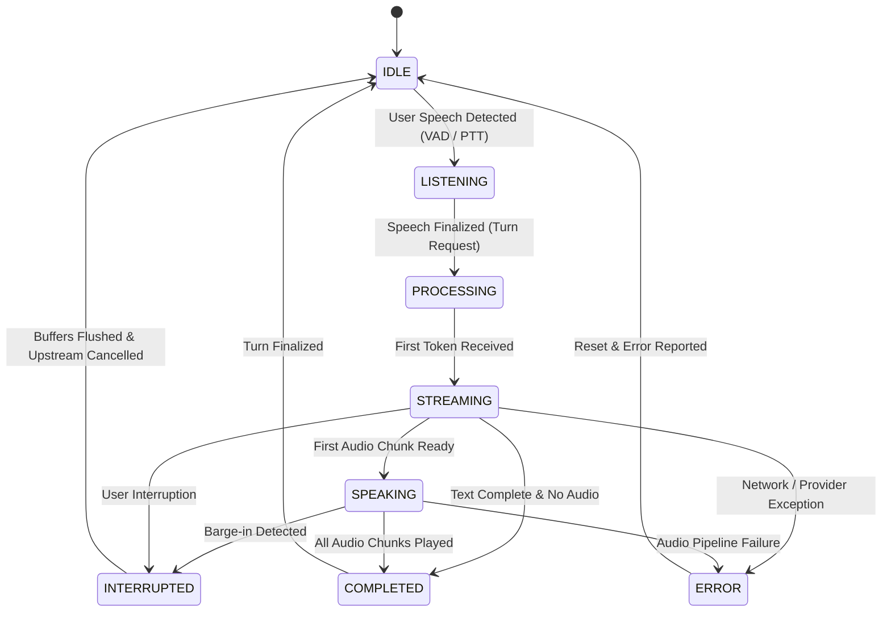

# Voice & Realtime Streaming State Machine

## 1. State Machine Architecture

HNA / HINA coordinates multi-modal text streaming, speech-to-text (STT), model generation, progressive text-to-speech (TTS), and local audio playback via an explicit, deterministic state machine.

---

## 2. Legal Interaction States & Invariants

| State | Allowed Transitions | Invariants & Operational Rules |
| :--- | :--- | :--- |
| `IDLE` | `LISTENING`, `PROCESSING` | Microphone in low-power VAD standby; no audio playback active; teletype sound stopped. |
| `LISTENING` | `PROCESSING`, `IDLE` | User speaking; client buffers audio frames; avatar displays attentive idle/listening expression. |
| `PROCESSING` | `STREAMING`, `INTERRUPTED`, `ERROR` | Turn submitted to backend; awaiting first token; thinking sound/visualizer active. |
| `STREAMING` | `SPEAKING`, `INTERRUPTED`, `COMPLETED`, `ERROR` | Tokens arriving; markdown UI updating incrementally; teletype sound active if voice session open. |
| `SPEAKING` | `INTERRUPTED`, `COMPLETED`, `ERROR` | Audio playing back via Web Audio API; lip-sync / viseme tracking active on avatar model. |
| `INTERRUPTED` | `IDLE`, `LISTENING` | User spoke during assistant output; audio queue cleared immediately; upstream request cancelled. |
| `COMPLETED` | `IDLE` | Markdown finalized; persistence committed; audio queue fully drained; state transitions cleanly. |
| `ERROR` | `IDLE` | Structured error displayed; text-only fallback preserved; audio buffers destroyed. |

---

## 3. Barge-In & Interruption Protocol (Software Implementation)

### 3.1 Interruption Sequence
1. When user speech energy is detected while in `SPEAKING` or `STREAMING` state, the client emits an `interrupt_turn` event over WebSocket with `{ currentTurnId, sequenceId }`.
2. The local Web Audio buffer source invokes `.stop(0)` on the active `AudioBufferSourceNode`.
3. The pending audio playback queue is immediately cleared.
4. Any in-flight generative teletype sound effects are halted.
5. The backend terminates the active LLM stream and cancels upstream TTS worker jobs.
6. The turn is marked as `INTERRUPTED` in state history, preserving partial text displayed prior to cutoff without corrupting future turns.

### 3.2 Late Audio & Stale Packet Rejection
- Every audio chunk carries `turnId` and monotonic `chunkIndex`.
- The client maintains `activeTurnId`.
- Any audio chunk where `chunk.turnId !== activeTurnId` is rejected and dropped silently.

---

## 4. Verification Status & Manual Testing Runbook

> [!WARNING]
> **Hardware & Acoustic Verification Status**: `NOT_MEASURED`
> While software state transitions, buffer clearing logic, and WebSocket cancellation protocols are fully implemented and verified via unit tests, physical acoustic latency (milliseconds from voice detection to speaker silence), acoustic echo cancellation (AEC), and microphone background rejection cannot be measured automatically in a headless CI/CLI environment. They require physical hardware testing.

### Manual Hardware Verification Procedure
1. **Prerequisites**: Connect physical microphone and stereo speakers on reference device (Windows 11 / macOS).
2. **Audio Calibration**: Set speaker output volume to 70% and microphone sensitivity to default in browser settings.
3. **Turn Initiation**: Speak a complex request requiring a multi-sentence vocal response (e.g., "Explain how WebRTC signaling works").
4. **Barge-In Execution**: While the assistant is actively speaking sentence 2, speak clearly: *"Hina, hold on a second."*
5. **Observation Criteria**:
   - Audio playback must cease abruptly without stuttering.
   - The microphone must not trigger false interruptions from the speaker output (verifying AEC effectiveness).
   - Generative teletype sound clicks must terminate immediately.
   - Partial text generated prior to interruption must remain visible in the chat bubble.
